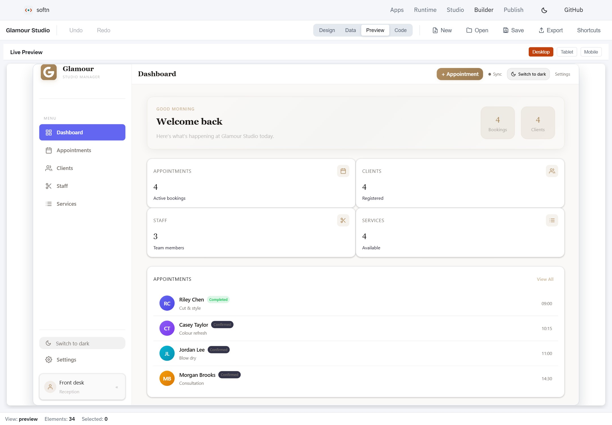
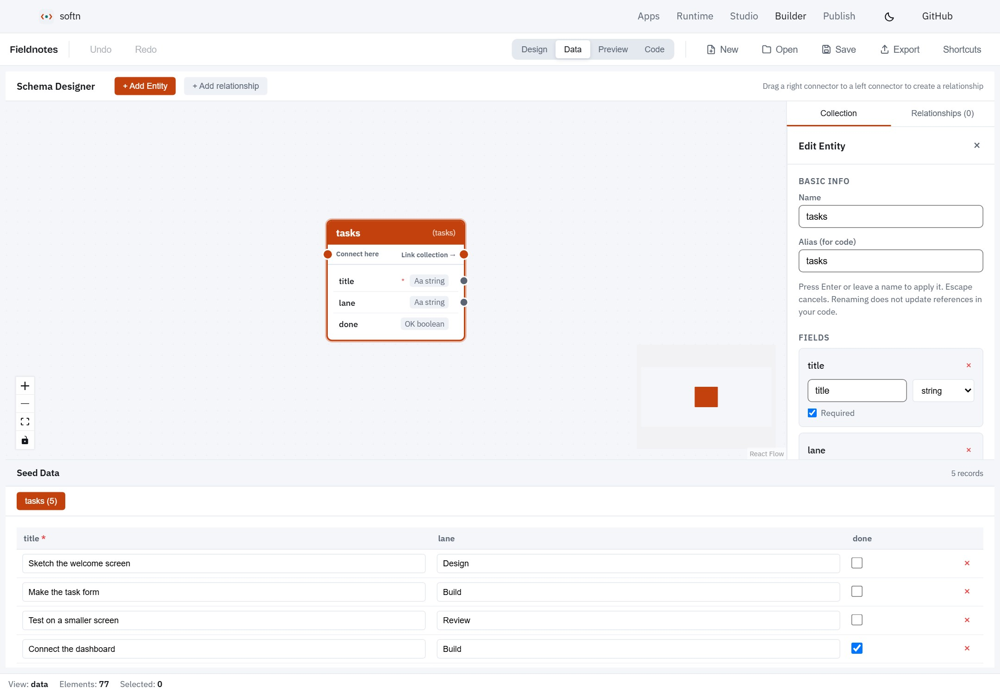
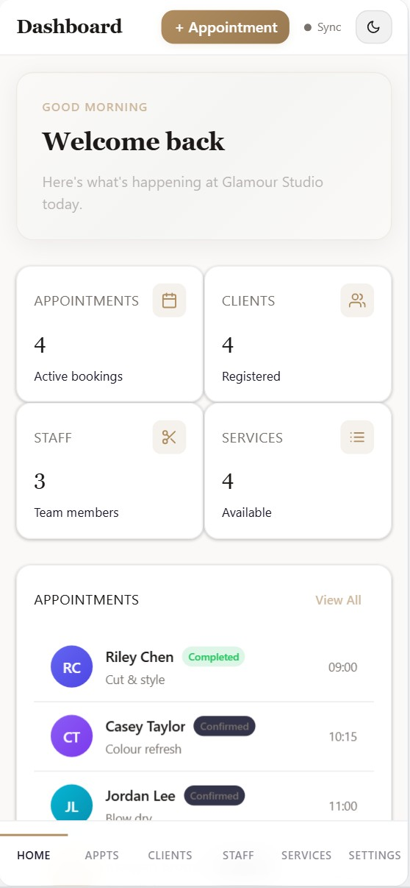
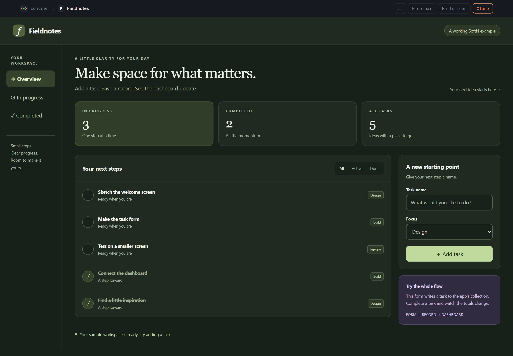

<div align="center">

# SoftN

### Docker for Sandboxed Web Apps — Build, Package, and Run Anywhere.

A lightweight WebAssembly container runtime, AI studio, and visual builder for sandboxed web and desktop apps.

[Explore apps](https://softn.com) · [Web Containers (v2)](#softn-v2-web-app-containers) · [Get started](#get-started) · [FormLogic integration](#connect-to-formlogic) · [Documentation](#documentation)

</div>



_Meet **Fieldnotes**: a working app whose form, logic running on ZIPP and XDB records update one dashboard. This is the actual Builder preview. [Read the source](examples/fieldnotes) · [Get the .softn bundle](apps/softn-site/public/examples/Fieldnotes.softn) · [Try the v2 Container Showcase](examples/container-showcase) · [Screenshot details](docs/readme-assets/README.md)._

SoftN packages full-stack web applications — frontend UI, sandboxed backend code, SQLite/XDB data seeds, and capability declarations — into portable `.softn` containers. With **SoftN v2 Web App Containers** (`@softn/container`), standard HTML, CSS, JavaScript, TypeScript, React, Vue, Svelte, or Three.js frontends run alongside optional sandboxed HTTP backends (**PHP/Slim 4**, **JavaScript/TypeScript**, **Rust/Axum**, or **Python**) and embedded **XDB SQLite 3 WASM** (`v0.1.0`) inside isolated [ZIPP](https://github.com/f2i-com/zipp.org) (`v0.0.37`) WebAssembly Workers and a closed Shadow DOM — completely locally in your browser with IndexedDB persistence, or hosted multi-user inside ZIPP `safe-sandbox` with zero app code changes. Classic **v1 `.ui` + `.logic`/`.py` bundles** continue to run with 100% backwards compatibility across the runtime, Studio AI, and Builder.

The project is actively developed. The examples, container microkernel, full-stack sandboxed backends, editors, and runtimes are usable today; host support and permission boundaries are documented below so you can choose the right deployment.

## What you can build

| Capability                     | What it gives you                                                                                                                                                                              |
| :----------------------------- | :--------------------------------------------------------------------------------------------------------------------------------------------------------------------------------------------- |
| **Full-Stack Web Containers (v2)** | Package standard HTML5, CSS, and ES modules (`.js` / `.ts` / `.py`) — or zip a Vite `dist/` build — together with an optional sandboxed HTTP backend (`php` / Slim 4, `javascript`, `typescript`, `rust`, `python`) and XDB SQLite 3 database in one `.softn` file. |
| **Sandboxed local & multi-user** | Every `fetch("/api/...")` runs locally in a ZIPP WebAssembly Worker with IndexedDB SQLite — or scales multi-user via directory `server`/`hybrid` hosting, `softn-server`, or `softn-host-php`, still strictly inside ZIPP `safe-sandbox` (never native OS PHP/Python/shell). |
| **Pay-as-you-go WASM engines** | Boots on `zipp-javascript-lite.wasm` (~770 KB Brotli) by default and lazily loads `zipp-javascript`, `zipp-typescript`, `zipp-python-base`, `zipp-php`, `zipp-rust` (`ZIPP v0.0.37`), and `xdb-wasm` (`v0.1.0`) only when an app requires them. |
| **Hosted zero-bundle imports** | Import `'preact'`, `'preact/hooks'`, `'htm'`, `'marked'`, Native V8 WebGL2 `'three'` + bundled `GLTFLoader`/`MeshoptDecoder` (`THREE.loadGLTF`), `<softn-chart>`, and `<softn-datagrid>` at 0 KB of bundle weight. |
| **Builder + SQLite Explorer**  | Hybrid IDE for v2 containers and 107-component v1 `.ui` apps, with a built-in **mini-phpMyAdmin XDB SQLite 3 explorer** (tables, columns, indexes, full CRUD, SQL console, `.sql`/`.db` export, live bundle sync), automatic session restore, and toolbar **Clear**. |
| **AI-assisted creation**       | Studio turns a brief into a full-stack v2 Web App Container (with optional PHP or JS/TS + SQLite backend) or a v1 `.ui` app using OpenAI, Anthropic, local (Ollama / LM Studio), or custom providers — plus built-in runnable examples with no key required. |
| **Local-first XDB & security** | App-scoped local records (`softn:db` / `xdb/*.xdb`) and IndexedDB SQLite with optional sync, plus strict capability consent (`permission.json`) for network allowlists, camera, microphone, files, GPU, and storage. |

## SoftN v2 Web App Containers

SoftN v2 (`@softn/container` / `<softn-app>`) treats `.softn` archives like **Docker containers for web apps**:

- **Bring your own code (the standard DOM, no custom DSL):** Write plain HTML + CSS + Vanilla JS/TS, use SoftN's zero-build hosted Preact/HTM modules, or zip the `dist/` folder a bundler wrote into a `.softn` or `.zip` file. **A React or Vue app built by Vite runs as built.** The gate builds one of each (React 18, Vue 3) with Vite's defaults and drives it by mouse and keyboard in a browser: a form the framework controls, a portal or teleport, a part loaded on demand with its own stylesheet, a transition, an error boundary, a router's links. React 19, React Router, emotion, styled-components, zustand, TanStack Query, Vue Router and Pinia were each run the same way by hand, and a smaller page built in Svelte 5, Solid and Preact. The page's script runs in a Worker against the container's own DOM, which covers what such code uses and not all of a browser's. `fetch` (with `response.body` read as it arrives), `XMLHttpRequest`, `WebSocket` and `EventSource` reach only the hosts the app declared and the person allowed; `Blob`, `File`, `FileReader`, `URL.createObjectURL`, `new Image()`, `element.animate`, `canvas.toBlob`, `MessageChannel`, `DOMParser`, `document.createRange`, `customElements` and shadow trees (`attachShadow`, slots) are there, and a Lit app runs. A file is saved only when the person says so in a bar the page draws, and a file they pick is read only by an app they allowed files (10 MB a pick). The app's page is in a shadow root of its own: its stylesheet reaches nothing of the container's or of the page it is embedded in. `IndexedDB` is there too, kept in the page's own IndexedDB under a quota of its own and shared by the same app's tabs in turn (Dexie, idb and localForage run), `crypto.subtle` is the browser's own, an element's `scrollTop` and `window.scrollY` read where the person has scrolled, and `canvas.toDataURL()` and `getImageData()` answer at once (with a picture from another site asked for with CORS among what is read); a classic `<script src>` may be of any size (jQuery and lodash run as plain files), and what one declares at its top, `let` and `const` included (in TypeScript too), the scripts after it can name, and so may a part loaded on demand when its `import()` names it as text. A `<script>` the app adds while it runs runs as in a browser (a webpack build's parts, jQuery's DOMEval, a loader's libraries), `document.currentScript` is the script running, a template or JSON kept in a `<script>` is there to read, and scripts run in a browser's order (`defer` and modules last, `nomodule` not at all). Code an app compiles itself while it runs (`eval`, `new Function`, a part loaded on demand by a computed name) is held to the engine's 64 KB a compilation; an app that stops says so on the page, with a way to start it again. An app's own `new Worker(url)` runs in an engine of its own beside it (classic or a module, from its files or a blob); an element's size is measured by the page and known a moment after it is drawn; an app that formats with `Intl` runs on the full engine, which is chosen for it. An Angular build has not been tried.
- **Hard Worker + Shadow DOM isolation:** Guest code never touches the host `window` or main thread. It executes inside a dedicated Web Worker on the Rust/WASM ZIPP VM while a lightweight host microkernel applies batched surgical DOM patches inside a closed `ShadowRoot` and enforces `permission.json` network/capability gates.
- **Sandboxed full-stack backends & XDB SQLite 3:** Declare `backend` (`php`, `javascript`, `typescript`, `rust`, or `python`) and `databases` (`engine: "sqlite"`, with `seedSql`, `seedJson`, or a bundled `.db`) in `manifest.json` alongside optional `frontendRoot` and `.htaccess` rewrite rules. Locally, `LocalBackendTransport` boots a dedicated ZIPP WASM backend Worker with a Virtual Cookie Jar and IndexedDB-persisted XDB SQLite 3 (`v0.1.0`); multi-user deployments switch to `RemoteBackendTransport` (`backendUrl`) against the directory API, `softn-server`, or `softn-host-php`, executing every request inside ZIPP `safe-sandbox` against shared WAL SQLite with zero app code changes.
- **Native V8 Three.js, GLTF & Custom Elements:** Guest scripts can write `import * as THREE from 'three'` (including `THREE.loadGLTF` powered by bundled `GLTFLoader` and `MeshoptDecoder`) or render to 2D `<canvas>` while WebGL2 draw calls execute natively on the host GPU without bundling Three.js inside the `.softn` file. Drop `<softn-chart>` or `<softn-datagrid>` into any HTML page to lazy-load rich UI widgets on demand.

```text
my-web-app.softn  (full-stack v2 container, or zip any Vite dist/ folder directly)
├── public/index.html   # Standard HTML5 entry (or root index.html; auto-discovered without manifest.json)
├── public/app.ts       # ES modules (.js, .mjs, .ts) or Python (.py) run in the ZIPP Worker
├── backend/index.php   # Optional sandboxed HTTP backend (PHP/Slim 4, JS/TS, Rust, or Python)
├── backend/schema.sql  # Optional SQLite schema/seed (or bundled *.db / seedJson)
├── manifest.json       # Optional. "engine": 2 plus optional frontendRoot, backend, and databases
├── permission.json     # Optional: the hosts the app may reach ("net"), asked of the person first
└── xdb/*.xdb           # Optional: seeded local collections accessed via `import { db } from 'softn:db'`
```

```html
<!DOCTYPE html>
<html lang="en">
  <head>
    <meta charset="UTF-8" />
    <title>Field Tracker</title>
    <link rel="stylesheet" href="softn:ui.css" />
  </head>
  <body class="container stack gap-md">
    <div id="app"></div>
    <script type="module">
      import { h, render } from 'preact';
      import { useState } from 'preact/hooks';
      import htm from 'htm';
      import { db } from 'softn:db';

      const html = htm.bind(h);
      function App() {
        const [items, setItems] = useState(() => db.query('tasks'));
        const add = () => {
          db.create('tasks', { title: `Item #${items.length + 1}` });
          setItems(db.query('tasks'));
        };
        return html`
          <div class="card stack gap-sm">
            <h1>Field Tracker (${items.length})</h1>
            <button class="btn primary" onClick=${add}>+ Add Task</button>
          </div>
        `;
      }
      render(html`<${App} />`, document.getElementById('app'));
    </script>
  </body>
</html>
```

Try the standalone multi-container showcase locally (featuring an unmodified compiled Kanban `dist/` bundle, a zero-build TypeScript + Preact + `softn:db` app, and a 1.5 KB Split-Realm Three.js 3D demo):

```bash
npm run demo:container   # builds @softn/container + showcase bundles and serves http://127.0.0.1:4830
```

Which engine runs a bundle is one rule everywhere: a bundle with a `manifest.json` is a web container when the manifest says `"engine": 2`, and a SoftN v1 bundle otherwise; an archive with no manifest (a zipped `dist/`) is a web container when it has a page to open.

On a page of your own, the container needs `script-src 'self' 'wasm-unsafe-eval'` (and `worker-src 'self'`) where a Content Security Policy is set: its engines are WebAssembly. An app's page is drawn inside the element's box and never over your page; a link out opens in a new tab, and the app's saved data is kept under the address its archive was loaded from.

The design proposal the container was built from is [`docs/rfcs/softn-v2-container.md`](docs/rfcs/softn-v2-container.md). It is a plan, and parts of it are not built.

## See an app powered by ZIPP

Fieldnotes is a small task planner you can use, inspect and change. Add a task,
mark it complete and watch the list and totals update. Its `.logic` executes on
[ZIPP](https://github.com/f2i-com/zipp.org); SoftN renders the interface and connects
the script to XDB. No AI provider or account is needed to try it.

| Follow the action | Open the source |
| :---------------- | :-------------- |
| **Enter a task.** The form binds its inputs and calls `addTask()` when you press the button. | [Interface and bindings](examples/fieldnotes/ui/main.ui) |
| **Run the logic.** ZIPP executes validation, creates the task record and refreshes the dashboard; `toggleTask()` updates completion. | [The app's .logic file](examples/fieldnotes/logic/main.logic) |
| **Keep the data.** The bundle supplies the collection schema and five sample tasks. Runtime saves your new records locally. | [Schema, seeds and bundle builder](examples/fieldnotes/build.mjs) |

Open the same bundle in Studio, Builder or Runtime. Change a heading visually,
edit the logic, switch themes or export the result as your own app. Builder's
preview has its own test records; use Data view to edit the seeds you ship.

**[Explore Fieldnotes](examples/fieldnotes/README.md)** · **[Run it locally](#get-started)** · **[Explore games, emulators and more](#demos)**

## From an idea to an app

1. **Start with a brief or a bundle.** Use Studio with your own AI provider, create a project in Builder, or open an existing `.softn` app.
2. **Shape the experience.** Edit pages, navigation, `.logic` behavior and the data model. Keep complex source intact in Code view.
3. **Try the whole flow.** Preview at desktop, tablet and mobile sizes, and use sample records to exercise forms and dashboards.
4. **Export and choose a host.** Run the bundle locally, publish it in the directory, deploy a single app, or host it through FormLogic.

<details>
<summary><strong>Inspect the collection behind the form</strong></summary>



_The same Fieldnotes app in Data view: the `tasks` collection, its field types and the five sample records carried by the bundle._

</details>

<table>
<tr>
<td width="65%" valign="top">
<h3>One app, different screen sizes</h3>
<p>The preview runs the actual app. Switch viewport sizes to check navigation, forms and content before you share it.</p>
<p>This is Fieldnotes running at a phone-sized viewport in dark mode. Its dashboard, filters and task form adapt to the available width, and the page scrolls to the rest of the workspace.</p>
<p>The runtime theme switch updates the app without clearing unfinished input. The same source provides both the warm light palette above and the dark palette shown here.</p>
<p>Responsive behavior still belongs to the app's layout: test your own pages and interactions at the sizes you intend to support.</p>
</td>
<td width="35%" align="center">

</td>
</tr>
</table>

<details>
<summary><strong>See the full app in dark mode</strong></summary>



_A direct screenshot of the running app. Its colours and responsive layout live in the editable `.ui` source._

</details>

## Get started

Use **Node.js 24.19 or newer** (see `engines` in `package.json`), and npm. The browser apps run on ZIPP's prebuilt WebAssembly engine, which is not committed: the first build, test or typecheck downloads the release `apps/softn-host-rust/Cargo.toml` names and verifies it (`npm run fetch:zipp`), so a fresh checkout needs network access once. Rust is only needed for native hosts.

```bash
git clone https://github.com/f2i-com/softn.com.git
cd softn.com
npm ci
npm run build:packages
npm run dev
```

Open the origin printed by the launcher, normally `http://localhost:1420`:

| Path        | Start here to…                                           |
| :---------- | :------------------------------------------------------- |
| `/`         | Learn the workflow and try the editable Fieldnotes app.  |
| `/apps`     | Search and browse the full app directory.                |
| `/builder/` | Create or reopen an app, edit its schema and preview it. |
| `/studio/`  | Configure your AI provider and turn a brief into an app. |
| `/web/`     | Open bundles, explore directory apps and return to your saved library. |
| `/docs/`    | Read the guides; they rebuild as `docs/content/softn-docs.json` is edited. |
| `/demos/`   | The example bundles the directory and Runtime link to.  |
| `/api/`     | The directory API, when PHP is on `PATH`.               |

The launcher proxies the browser apps through one origin and picks alternate ports when needed. It also starts the directory API when PHP is available on `PATH`; install PHP to exercise directory browsing, publishing and server storage locally. Fetched examples appear in both the directory and Runtime when demo seeding is enabled. Demo fetching needs network access. To work on Builder alone, use `npm run dev:builder` after the package build.

Runtime keeps apps running when you return to its workspace, so you can browse the directory and open another app without losing an unfinished form. Use **Home** to switch apps, **Close** to stop the current one, or **Close all** on the launcher to stop every running app at once. Apps you open are kept in this browser's library with offline readiness shown for each saved app; removing an app or pressing **Remove all** happens immediately without blocking confirmation dialogs and shows a floating toast with single-step **Undo**.

In Builder, reopening `/builder/` automatically restores your last workspace without a blocking prompt; use **Clear** in the toolbar to cleanly reset the workspace and clear stored session state. For any `.softn` project with SQLite (`.db`/`.sqlite`, `manifest.databases`, or backend `.sql` migrations), Builder's **Data** tab opens a **mini-phpMyAdmin XDB SQLite 3 explorer** where you can create/alter/drop tables, columns, and indexes, browse/insert/edit/delete/truncate rows, run SQL queries, export `.sql`/`.db`, and sync changes straight back into the `.softn` bundle.

For a first project, open the homepage's **Fieldnotes** example in Builder, select its heading and change **Text Content**, then use **Preview** and **Export** — or scaffold a new **Web Container (v2)** with a **PHP + SQLite** or **JS/TS API + SQLite** backend. Use **Open** to bring your exported app back into Studio, Builder or Runtime. The [Fieldnotes source](examples/fieldnotes) and [v2 container showcase](examples/container-showcase) are included in this repository; [softn-Examples](https://github.com/f2i-com/softn-Examples) contains the wider demo catalogue.

## Connect to FormLogic

SoftN supplies the editable app and runtime. [FormLogic](https://formlogic.com) supplies the hosted workspace: forms, records, backend actions and app databases. There are two distinct integration paths:

| Path                               | How it works                                                                                                                                                                                                                                                    |
| :--------------------------------- | :-------------------------------------------------------------------------------------------------------------------------------------------------------------------------------------------------------------------------------------------------------------- |
| **Download a form or app starter** | The canonical [FormLogic adapter](packages/@softn/core/src/integrations/formlogic.ts) converts supported form schemas into an editable `.softn` bundle. It starts with local XDB data and `sync: false`. Responses, credentials and access grants are excluded. |
| **Run a connected workspace**      | The [FormLogic host](apps/formlogic-host/src/main.tsx) renders app source inside an isolated iframe. Client `.logic` calls named backend actions through `softn.backend.call`; the parent owns authentication and applies the selected app's permissions.       |

Use the editable [FormLogic workspace](examples/formlogic-workspace) and [Aokie workspace](examples/aokie-workspace) as examples of connected dashboards. Aokie's app brings calls, appointments, messages, follow-ups and transcripts into one interface; its communication services run through the host integration.

For an app with custom backend `.logic` and SQLite, configure those server resources in the hosting platform and expose the actions the client needs. Keep private scripts, credentials and databases on the server. Downloading the client bundle does not copy a live backend or grant access to it.

The [starter conversion guide](docs/engineering/FORMLOGIC_INTEGRATION.md) explains schema mapping and export boundaries. The host source and workspace examples above show the connected runtime; [private backend deployment](apps/softn-host-rust/PRIVATE_BACKEND.md) covers SoftN's own server host.

## Choose where it runs

| Destination                 | Guide                                                                                                                                   |
| :-------------------------- | :-------------------------------------------------------------------------------------------------------------------------------------- |
| **Browser or desktop**      | Open a v2 full-stack container or v1 bundle in [SoftN Web](apps/softn-web) or the [Tauri loader](apps/softn-loader).                    |
| **App directory (flexible)** | Publish a bundle with its own page, browser player, category (including Business Apps), optional server storage, and per-app `hosting` mode (`browser`, `server`, or `hybrid` inside ZIPP `safe-sandbox`). See the [directory guide](apps/softn-api/README.md). |
| **Your own website**        | Deploy the app in an unbranded [single-app runtime](docs/engineering/SINGLE_APP_RUNTIME.md) (with optional `backendUrl`).               |
| **Private PHP deployment**  | Serve a single app from a private archive using the [PHP deployment guide](docs/engineering/SINGLE_APP_PRIVATE.md).                     |
| **Multi-user sandboxed backend** | Host v1 `server/*.logic` or v2 PHP/JS/TS/Rust/Python container backends strictly inside ZIPP `safe-sandbox` on the [Rust server](apps/softn-host-rust/PRIVATE_BACKEND.md) or [PHP on-demand host](apps/softn-host-php/SINGLE_APP_DEPLOYMENT.md). |
| **FormLogic**               | Use the connected host and named backend actions / `containerHttp` bridge described above.                                              |

A `.softn` archive can be either a **v2 Web App Container** (standard HTML/CSS/JS/TS or a zipped `dist/` build, with optional sandboxed `backend` and XDB SQLite `databases`) or a **v1 Visual `.ui` Bundle**:

```text
# v2 Web App Container (.softn or .zip)        # v1 Visual Component Bundle (.softn)
my-web-app.softn                               my-ui-app.softn
├── index.html          # Standard HTML5       ├── manifest.json       # App identity & entry
├── app.ts / assets/*   # ES modules & CSS     ├── permission.json     # Requested capabilities
├── backend/*           # Optional PHP/JS/RS/Py├── ui/                 # .ui pages & components
├── manifest.json       # Optional metadata    ├── logic/              # .logic or .py scripts
├── permission.json     # Optional permissions ├── xdb/                # Optional seed data
└── xdb/ or *.db        # Optional seeds/SQLite└── assets/             # Images & styles
```

Capabilities such as network, microphone and synchronization require support and permission from the host. An app's bundle is portable; include only material you intend to distribute in client downloads (or set `"withhold_backend": true` in server-hosted directory mode / `softn-single-private` so backend source stays on the server).

## Documentation

| Topic                   | Read next                                                                                                                                                      |
| :---------------------- | :------------------------------------------------------------------------------------------------------------------------------------------------------------- |
| The guides              | [softn.com/docs](https://softn.com/docs/): thirty-five pages from "What is SoftN?" and full-stack Web Containers to flexible hosting, generated from [`docs/content/softn-docs.json`](docs/README.md) |
| v2 Web Containers       | [Full-Stack Web Containers guide](https://softn.com/docs/web-containers/) · [Architecture RFC](docs/rfcs/softn-v2-container.md) · [Container showcase](examples/container-showcase) |
| Language and components | Expand the reference below for v1 `.ui`, `.logic`, SmartForm, SmartGrid, audio and 3D examples.                                                                |
| Data modeling           | [Builder collections, ER relationships and record references](docs/engineering/BUILDER_DATA.md)                                                                         |
| Loading and composition | [Bundle loading](docs/engineering/BUNDLE_LOADING.md) · [Component loading](docs/engineering/COMPONENT_LOADING.md) · [Reopening local apps](docs/engineering/LOCAL_APP_REOPEN.md)                   |
| Hosting                 | [Single-app runtime](docs/engineering/SINGLE_APP_RUNTIME.md) · [Private PHP serving](docs/engineering/SINGLE_APP_PRIVATE.md) · [Private backend](apps/softn-host-rust/PRIVATE_BACKEND.md) |
| FormLogic               | [Starter adapter](docs/engineering/FORMLOGIC_INTEGRATION.md) · [Connected host](apps/formlogic-host/src/main.tsx) · [Workspace examples](examples)                         |
| Local speech            | [Local speech guide](docs/engineering/LOCAL_SPEECH.md)                                                                                                                     |
| Development             | [Setup, tests and key source paths](#development)                                                                                                              |

<details>
<summary><strong>Language, components, runtime and deployment reference</strong></summary>

## Architecture Overview

### v2 Web App Container Pipeline (`@softn/container`)

```
.softn / .zip (HTML + CSS + JS/TS/Py + optional PHP/JS/TS/Rust/Python backend + SQLite)
      |
      +---> Sanitized HTML + Scoped CSS ---> Closed ShadowRoot (<softn-app>)
      |                                             ^
      |                                             | Batched DOM Mutations &
      v                                             | Native V8 Three.js / WebGL2 / Canvas Ops
  Frontend Worker -> Tiered ZIPP WASM VM -----------+
                     (lite / js / ts / python)
                        |
                        +---> Hosted `/runtime/vendor/*` (preact, htm, marked, three + gltf-loader)
                        +---> Gated `softn:*` bridges (`softn:db`, `softn:net`, `softn:storage`)
                        +---> BackendTransport (/api/* & SSR):
                                ├── LocalBackendTransport  -> ZIPP Backend Worker (php/js/ts/rust/py) + XDB SQLite 3 WASM (IndexedDB)
                                └── RemoteBackendTransport -> softn-api / softn-server / softn-host-php (ZIPP safe-sandbox + WAL SQLite)
```

### v1 Visual `.ui` & `.logic` Pipeline (`@softn/core` + `@softn/components`)

```
.softn/.ui Source
      |
      v
  +-------+     +---------+     +----------+     +----------+
  | Lexer | --> | Parser  | --> | Renderer | --> |  React   |
  +-------+     +---------+     +----------+     +----------+
   Tokens         AST             Elements         Display
                                    |
                                    v
                            Component Registry
                           (107 built-in + custom)

.logic Source
      |
      v
  +-------+     +---------+     +----------+     +----------+
  | Lexer | --> | Parser  | --> | Compiler | --> | zipp VM  |
  +-------+     +---------+     +----------+     +----------+
   Tokens         AST            Bytecode        Register-based
                                                 execution (Rust)
```

### State Flow

```
Script VM Globals     <--sync-->  React componentState  -->  Render Context  -->  UI
         |                                                        ^
         v                                                        |
    VM Bridges (db, localStorage, window, navigator)         Expression eval
```

Before each script function call, all React state is synced to VM globals. After the call returns, VM globals are synced back to React state, triggering a re-render.

---

## SoftN Language Syntax

### Quick Example

```xml
<logic>
  let count = 0

  function increment() {
    count = count + 1
  }
</logic>

<App theme="dark">
  <Stack direction="vertical" gap="md" padding="lg">
    <Heading level={1}>Counter</Heading>
    <Text>Count: {count}</Text>
    <Button variant="primary" @click={increment}>Increment</Button>
  </Stack>
</App>
```

### Props, Events, and Data Binding

```xml
// String and expression props
<Button variant="primary" size="md">Click Me</Button>
<Text color={isDark ? "white" : "black"}>{message}</Text>

// Event handlers
<Button @click={handleClick}>Click</Button>

// Two-way binding
<Input :bind={username} placeholder="Enter name" />

// Event modifiers: cancel the default, act on one key, ignore clicks from inside
<form @submit.prevent={save}>
  <Input :bind={title} @keydown.enter={save} @keydown.escape={cancel} />
</form>
<Box className="backdrop" @click.self={close} />

// One class or one style property from one expression
<div class="row" class:is-selected={row.id === selectedId} style:--accent={theme.accent} />

// Conditional rendering (#elseif and #else if are the same branch)
#if (isLoggedIn)
  <Dashboard />
#else if (isLoading)
  <Spinner />
#else
  <LoginForm />
#end

// Loop rendering
#each (task in tasks)
  <TaskCard task={task} />
#empty
  <Text>No tasks yet!</Text>
#end
```

### Expressions

What goes in braces is JavaScript's expression syntax, read by SoftN's own
parser and evaluated by the host page (logic runs in the zipp sandbox; a
template only reads state and calls the app's functions):

```xml
<Text>{tasks.filter(t => !t.done).length} left</Text>
<Text>{Math.max(0, ...scores)}</Text>
<Box style={{ ...cardStyle, opacity: busy ? 0.5 : 1 }} />
<Text>© {new Date().getFullYear()}</Text>
<Button @click={() => count++}>Add one</Button>
{/* A comment in braces renders nothing. */}
```

| Form | Examples |
| :--- | :------- |
| Arrow functions | `t => t.done`, `(a, b) => a - b`, `() => save()`, and in a handler a block body, `() => { count++; save() }` |
| Spread | `[...done, item]`, `Math.max(...scores)`, `{ ...base, color: "red" }` |
| Assignments and updates in a handler | `count = 0`, `count += 1`, `count++`, `open = !open` |
| Operators | `+ - * / % **`, comparisons, `&& \|\| ??`, `!`, the bitwise operators and shifts `& \| ^ ~ << >> >>>`, `typeof`, `in`, `instanceof`, `?.` |
| Values | numbers including `0xff`, strings, template literals, `true`, `false`, `null`, `undefined` |
| Construction | `new Date(…)`, `new Array(…)`, `new Map(…)`, `new Set(…)` and the `Intl` formatters (`new Intl.NumberFormat(…)`, `new Intl.DateTimeFormat(…)` and the rest), and nothing else |
| Globals | `Math`, `JSON`, `Intl`, `Number`, `String`, `Boolean`, `Array`, `Date`, `Map`, `Set`, `Object.keys`/`values`/`entries`, `parseInt`, `parseFloat`, `isNaN`, `isFinite`, `encodeURIComponent`, `decodeURIComponent`, `NaN`, `Infinity`, and the built-in helpers (`formatDate`, `currency`, `truncate`, …) |

A variable may be called `data`, `style`, `from`, `end` or any other word
markup also uses. `function` expressions, `async`/`await` and regular
expression literals are not read; the parser reports them, and the place for
them is a logic function the expression calls. A handler's block body runs its
statements one after another, each an expression of the kinds above; an `if`,
a `let` or a loop in it is reported, and that handler does nothing. Every
construct either parses to what it says or produces a
diagnostic: `parse(source).diagnostics`. An assignment or `++` changes state
when a handler runs it; written in the body of the page (`{count++}`) it would
run on every drawing, so there it is worth its value and changes nothing.

### Events

A handler bound by name gets the event as plain data, never the DOM event:
`@click={fn}` runs `fn(event)` with a record of its `type`, the pointer's
`clientX`/`clientY` or the key and its modifiers, and `target` and
`currentTarget` as data (`value`, `checked`, `dataset` and the like), the shape
the Scripting Engine section below describes. Component callbacks that carry
data (`DPad`'s `@press`, `Slider`'s `@change`) pass that instead. A script can
also listen on the window: `window.addEventListener("pointerdown", fn)` hands
`fn` a record of the same kind. `Box` and `Button`
forward `@pointerdown`, `@pointerup`, `@pointercancel` and `@pointerleave`,
which is enough for a hold-to-press control.

Because the script never holds the event, what would be `preventDefault()` or
a key test is written as a modifier after the event name: `.prevent`, `.stop`
and `.self` (only when the event happened on the element itself); the keys
`.enter`, `.escape`, `.space`, `.tab`, `.up`, `.down`, `.left`, `.right`,
`.backspace` and `.delete`; and the held keys `.ctrl`, `.shift`, `.alt` and
`.meta`, as in `@keydown.ctrl.enter={send}`. A filter that does not match
leaves the event alone. Whatever `:bind` does on the same event always runs.

---

## Component Library (107 Components)

| Category   | Count | Components                                                                                                                                      |
| ---------- | ----- | ----------------------------------------------------------------------------------------------------------------------------------------------- |
| Layout     | 15    | `App`, `Box`, `Stack`, `Grid`, `Card`, `Container`, `Center`, `Layout`, `Header`, `Content`, `Section`, `Sidebar`, `Split`, `Spacer`, `Divider` |
| Form       | 18    | `Button`, `ButtonGroup`, `CopyButton`, `Input`, `NumberInput`, `TextArea`, `Select`, `SegmentedControl`, `Checkbox`, `Radio`, `Switch`, `Rating`, `Form`, `Field`, `Slider`, `DatePicker`, `ColorPicker`, `FileChooser`|
| Display    | 15    | `Text`, `Heading`, `Badge`, `Tag`, `TagGroup`, `Avatar`, `AvatarGroup`, `Progress`, `Spinner`, `Skeleton`, `Image`, `Icon`, `Stat`, `Kbd`, `DescriptionList`|
| Feedback   | 7     | `Alert`, `Modal`, `Confirm`, `Toast`, `Drawer`, `Popover`, `EmptyState`                                                                         |
| Data       | 7     | `List`, `ListItem`, `Table`, `DataGrid`, `TreeView`, `Pagination`, `Timeline`                                                                   |
| Navigation | 5     | `Tabs`, `Breadcrumb`, `Menu`, `NavItem`, `Steps`                                                                                                |
| Utility    | 13    | `Accordion`, `Collapse`, `Tooltip`, `Loop`, `PixelGrid`, `PixelCanvas`, `QRCode`, `QRReader`, `Camera`, `Microphone`, `AudioStream`, `DPad`, `Controls` |
| Charts     | 6     | `LineChart`, `BarChart`, `PieChart`, `AreaChart`, `RadarChart`, `GaugeChart`                                                                    |
| Animation  | 9     | `AnimatedBox`, `AnimatedNumber`, `Marquee`, `Typewriter`, `Draggable`, `SortableList`, `PanView`, `Sprite`, `TileMap`                           |
| Editors    | 3     | `CodeEditor`, `MarkdownEditor`, `RichTextEditor`                                                                                                |
| 3D         | 1     | `Scene3D` (Three.js with GLTF, OBJ, FBX, STL)                                                                                                   |
| Smart      | 7     | `SmartGrid`, `SmartView`, `SmartForm`, `SmartCards`, `SmartList`, `SmartTimeline`, `SmartStats`                                                 |

The controls that hold one value bind like an `Input`, and hand back the value
itself rather than an event or its text:

```xml
<SegmentedControl :bind={view} options={["List", "Board", "Calendar"]} />
<NumberInput :bind={quantity} min={1} max={99} />
<Rating :bind={score} max={5} />
<Steps items={["Cart", "Shipping", "Payment"]} :bind={step} />

<Stat label="Open tasks" value={open} change={-12} changeLabel="since last week" positive="down" />
<Timeline items={history} />
<Skeleton loading={busy} lines={3}><Text>{summary}</Text></Skeleton>
<Text>Press <Kbd keys="Ctrl+K" /> to search</Text>
```

And the pieces an app would otherwise lay out by hand each time:

```xml
<DescriptionList items={[{ label: "Customer", value: order.name }, { label: "Paid", value: order.paid }]} columns={2} />

<Field label="Volume" hint="Applies to every sound." error={volumeError}>
  <Slider :bind={volume} />
</Field>

<ButtonGroup ariaLabel="Range">
  <Button @click={() => range = "day"}>Day</Button>
  <Button @click={() => range = "week"}>Week</Button>
</ButtonGroup>

<Confirm open={asking} title="Delete this note?" message="This cannot be undone."
         confirmText="Delete" variant="danger"
         @confirm={() => remove()} @cancel={() => asking = false} />

<AvatarGroup max={3}>
  #each (person in people) key={person.id}
    <Avatar name={person.name} />
  #end
</AvatarGroup>
```

---

## Smart Components

Auto-configured, data-driven components:

```xml
<data><collection name="clients" as="clients" /></data>

<SmartGrid
  data={clients}
  columns="name, email, phone, visits"
  searchable sortable pageable
  editable delete
  onEdit={editClient}
  onDelete={deleteClient}
/>

<SmartForm
  collection="clients"
  fields="name:text:required, email:email:required, phone:text"
  onSaved={closeModal}
  submitText="Add Client"
/>
```

---

## Bundle Format (.softn)

SoftN applications are distributed as `.softn` bundles (ZIP archives).

```
MyApp.softn (ZIP archive)
+-- manifest.json          # App metadata and configuration
+-- permission.json        # Capabilities the app needs, and what the user approves
+-- ui/main.ui             # Main entry point
+-- logic/main.logic       # Application logic
+-- server/*.logic         # Optional: routes run by softn-server, not the browser
+-- xdb/*.xdb              # Collection data (JSON)
+-- assets/*               # Images, CSS, etc.
```

`permission.json` is not optional in practice. The runtime denies every gated
capability — network, camera, microphone, filesystem, QR scanning, AI, GPU,
sync (peer-to-peer and through a sync server), server storage and host
acceleration — to a bundle that does not declare it, and the consent prompt is built from what it
declares, so an app that ships without one can run but cannot reach the host:

```json
{ "permissions": { "net": { "enabled": true, "allowed_hosts": ["api.example.com"] } } }
```

`allowed_hosts` names each host exactly as a URL writes it, in lower case, with
no port and no wildcard. Only `https` is allowed unless the entry also says
`"allow_http": true`, which a machine on the local network reached at an
`http://` address needs as well as its name in the list.

Storage identity and permission grants are host-specific. The general bundle loader isolates bundles by digest; configured single-app and FormLogic hosts supply their own deployment identity. A manifest name alone does not grant access to another app's records. See the [single-app identity rules](docs/engineering/SINGLE_APP_RUNTIME.md#permissions-and-local-records).

---

## Scripting Engine

`.logic` files are JavaScript, executed by [zipp](https://github.com/f2i-com/zipp.org) -- a clean-sheet
JavaScript engine written in Rust and compiled to WebAssembly.

```
Source Code -> Lexer -> Parser -> Compiler -> Bytecode -> Register-based VM (Rust/WASM)
```

- Real JavaScript: classes, async/await, destructuring, spread/rest, closures, regex
- Rust + WASM register VM with per-call-site inline caches, via `wasm-bindgen`
- True sandboxing: the script reaches nothing the engine preamble does not hand it
- Host modules: `db`, `localStorage`, `window`, `navigator`, `host`, plus the `softn.*` async APIs
- Browser events reach a handler as plain data, the same shape everywhere: a key event carries
  `key`, `code`, the modifiers, `repeat` and `isComposing`; a pointer event carries `clientX/Y`,
  `button`, `buttons` and the target's rectangle (`targetLeft/Top/Width/Height`), so a script can place
  the pointer within a canvas scaled to fit its box; both say `targetTag` and `targetEditable`
- `softn.input.captureKeys(["ArrowUp", " ", "F1"])` names the keys a script wants whole: the
  browser's default for them (scrolling, a page search) is cancelled before the handler runs,
  never in a text field, never for Ctrl with a character key (Ctrl+F, Ctrl+C) and never with the
  system modifier; Ctrl with an arrow or another named key is still captured
- A key listener on the window hears a key after the browser has acted on it, so calling
  `preventDefault()` on its record does nothing; the record's `defaultPrevented` says whether the
  key was captured, and the runtime says so once in the console when a listener calls it for a key
  that was not
- `_init()` runs once when the app has loaded; `_onHide()` and `_onShow()`, where the logic defines
  them, run when the app goes to the background (another app chosen in a host that keeps several
  open, the browser's tab hidden) and when it comes back; an app that starts in the background is
  told `_onHide()` once, after `_init()`
- When 32 calls are waiting for the engine, a call from an event that goes on reporting is left out,
  since the next one supersedes it: `@tick`, `@hover`, the pointer moving (`@pointermove`,
  `@mousemove`, `@touchmove`), `@scroll`, `@wheel`, `@drag`, `@dragover`, `@timeupdate`, `@level`,
  `@fps` and `@frame`. A call from any other event (a click, a key, a change, a submit) is never
  left out, whatever its function is called
- `requestAnimationFrame` hands its function the clock `performance.now()` reads

The compiled engine is not committed: `packages/@softn/core/wasm-zipp/` is installed from a ZIPP
release, already built, so building SoftN needs no Rust toolchain. The browser engine is taken
unchanged from that ZIPP release's official `zipp-<version>-javascript-python-base.wasm`:
JavaScript and experimental Python in one module, 6.58 MB, without torch. Since ZIPP 0.0.26 an
engine module carries its own JavaScript bindings in a `zipp.glue` section, which the install
writes out as `zipp_wasm.js`. Torch is ZIPP's separate package
(`zipp-<version>-torch-package.wasm`, 2.16 MB), installed beside the engine with a small loader
SoftN generates, and loaded by the runtime only for an app whose manifest declares torch, once per
page. The install's `SOURCE.json` records the
release, its source commit, the SHA-256 of each module and of the release's `SHA256SUMS`,
and where the third-party notices came from. Existing `.logic` screens continue to use JavaScript.
See [language support](docs/engineering/ZIPP_LANGUAGES.md) for the Python host API and its current
integration limits.

The release is the one the `zipp-vm` tag in `apps/softn-host-rust/Cargo.toml` names, so a commit
builds against the same ZIPP today and next year, and the Rust host and the browser run one engine.
`npm run build`, `npm test`, `npm run typecheck` and `npm run licenses:check` install it when it is
missing or not that release (`fetch-zipp-release.mjs --ensure`), so a fresh clone needs network
access the first time, or `ZIPP_RELEASE_DIR=<folder>` holding the release's `SHA256SUMS`,
`zipp-<version>-javascript-python-base.wasm`, `zipp-<version>-javascript.wasm`,
`zipp-<version>-torch-package.wasm` and `zipp-<version>-wasm-embed-kit.zip`. To install it by hand:

```bash
npm run fetch:zipp                      # the release Cargo.toml declares
npm run fetch:zipp -- --check           # re-verify the install offline (digests, fields, import/export subset)
```

`fetch:zipp` checks each file against the release's `SHA256SUMS` and installs the engine module
byte for byte. The module must carry one `zipp.meta` record naming the javascript-python-base engine
of that release and a full commit, and the bindings that record names; its stack must be 16 MiB;
and, loaded under those bindings, it must report the same release and commit and no torch built in.
It refuses anything else as the engine. The engine's TypeScript declarations and `LICENSE-APACHE`
come from the release's embed kit, whose own `SHA256SUMS`, `BUILD-INFO.txt` and `modules.json` must
agree with the release and the engine's commit. The release's torch package is installed beside it,
into `packages/@softn/core/wasm-zipp-torch/`: checked against the same `SHA256SUMS`, its record
naming the engine's commit, and, at install, really added to the engine by the loader SoftN ships,
after which the engine lists torch and an `import torch` project runs. `wasm-zipp/SOURCE.json`
names it under `packages.torch`. The same release's JavaScript-only `zipp-<version>-javascript.wasm`
is installed beside it, into `packages/@softn/core/wasm-zipp-web/`, as a verified *variant*: checked
against the same `SHA256SUMS`, built from the same commit, importing nothing the engine does not and
exporting nothing it lacks, and, loaded under the engine's glue, reporting `["javascript"]` alone
with its Python entry points refusing. Softn's own apps never use it; `wasm-zipp/SOURCE.json` names
it under `variants.web` so the FormLogic runtime archive can carry it as `zipp-web/` for a FormLogic
that offers the smaller engine. An install without the variant or the package is refused: one
release, all of it, or nothing. ZIPP releases before 0.0.26 published zip bundles instead, which
`fetch:zipp` no longer reads.
The load probes run at install; `--check` (offline) re-verifies the installed
bytes — every digest, the recorded fields, each module's record and stack, that `zipp_wasm.js` is
the engine's own `zipp.glue` section, that the variant's imports and exports are a subset of the
engine's, and that the package module imports nothing and exports what its loader reads — and loads
nothing. `--check --online` compares an install with the published release, and
`ZIPP_RELEASE`/`ZIPP_SUMS_SHA256` name the release and the `SHA256SUMS` digest an install must have.
`-- vX.Y.Z` or `-- --latest` installs another release once, but the next build, test, typecheck or
licence script puts the declared release back (with a warning). To build and test against another
release, set it for every command, for example `ZIPP_RELEASE=vX.Y.Z npm test`; the engine-pin
tests then fail until the Cargo tag and `Cargo.lock` agree.
The release carries no Unicode notice, so SoftN ships a curated copy from
[zipp-notices/](packages/@softn/core/zipp-notices/README.md).

To move to a new ZIPP release, bump the `zipp-vm` tag and `Cargo.lock` together; the next build
installs that release. A SoftN release asks ZIPP for its latest release and refuses to ship any
other (an older one, or a newer pre-release) unless it is dispatched with `allow-older-zipp` (or
`[allow-older-zipp]` in the tag message), which the release notes then record; every job of that
run installs the one release the gate froze.

To try an unreleased engine from a sibling `zipp.org` checkout, `npm run build:zipp-wasm -w @softn/core`
builds into `packages/@softn/core/.cache/zipp-local/` (Rust with the `wasm32-unknown-unknown`
target, wasm-bindgen 0.2.126 and wasm-opt), and
`node packages/@softn/core/scripts/fetch-zipp-release.mjs --install-local packages/@softn/core/.cache/zipp-local`
installs it as a `local` build, which no release step accepts.

The engine is selected in one place -- `packages/@softn/core/src/runtime/vm-adapter.ts`.

Hosts that already use the same engine can call `configureZippWasmSource(bytes)` before SoftN
initializes. FormLogic uses this to download and verify the binary once, then send copies to
its expression worker and hosted SoftN apps. Each worker or app keeps its own instance, memory
and permissions. See the [FormLogic host integration](apps/formlogic-host/README.md).

```javascript
let clients = [];

function _init() {
  clients = db.query('clients');
}

function addClient(name, email) {
  db.create('clients', { name: name, email: email });
  clients = db.query('clients');
}
```

---

## XDB Database

Local-first, reactive database with P2P synchronization. In the browser it is
SoftN's own service (`packages/@softn/core/src/runtime/xdb.ts`); the desktop
runtime and the Rust server store records with the XDB crate in
[`crates/softn-xdb`](crates/softn-xdb) ([notes](docs/engineering/xdb/README.md)).

```javascript
let client = db.create('clients', { name: 'John', email: 'john@example.com' });
let allClients = db.query('clients');
db.update(client.id, { phone: '555-1234' });
db.delete(client.id);
db.startSync('my-room-name');
```

All CRUD operations are **synchronous** (XDB caches everything in memory).
`db.startSync` returns nothing; there is nothing to await.
Peer sync runs while the app is on screen: in SoftN Web, an app's rooms wait
while another tab is shown, exchange what was written meanwhile when it is
shown again, and close when the app closes. Server sync (`config.server.url`)
is live while the app is shown; behind another tab it connects only to send
what the app writes, and lets the socket go 30 seconds after
(`restAfterMs` on `XDBServerSync`).

Server sync replicates the app's records through a `softn-server` host
([`PRIVATE_BACKEND.md`](apps/softn-host-rust/PRIVATE_BACKEND.md)) named in the
manifest's `config.server`: `url` (an `https` or `wss` address; `http` and `ws`
reach only this computer, `localhost` or `127.0.0.1`), `token` (the host's sync token, which everyone with the
bundle can read and which opens the host's sync and nothing else; the operator
token, `auth_token`, is never sent) and `collections` (the collections it
carries; every one without it). SoftN Web and the desktop runtime connect, and
only when `permission.json` declares `sync` and the person allows it; when the
declaration's `net` lists `allowed_hosts`, the server's host must be one of them.

---

## Audio

`softn.audio` plays sound from a `.logic` script. Paths are resolved inside the
bundle, the same way `asset()` resolves them for a template.

```javascript
softn.audio.play('assets/pickup.wav');
softn.audio.play('assets/theme.mp3', { volume: 0.4, loop: true }, function (r) {
  themeHandle = r.handle;
});
softn.audio.setVolume(0.5); // scales what is playing now, and what comes next
softn.audio.stop(themeHandle);
softn.audio.stopAll();
```

No capability is declared for the bundle's own sounds: a template can already
write `<audio src={asset("…")} autoPlay />` with none, so gating the API and not
the tag would inconvenience the tidier route and secure nothing. Such a sound
reads nothing and sends nothing, and everything an app started stops when it
closes. A remote address (`https://…`) is a request to another host, and needs
`net` and a host `allowed_hosts` permits, as `softn.net.fetch` does.

Browsers refuse to make noise before the user has interacted with the page. A
one-shot that lands in that window reports `{ played: false, blocked: true }`
rather than throwing — playing it later would be a sound effect at the wrong
moment. Anything `loop`ing is treated as a soundtrack and starts on the first
click or keystroke instead.

---

## Microphone

Listening, unlike playing, is gated: `mic` has to be in `permission.json`, and
the consent prompt names it. The comment above the audio API argues that sound
is a nuisance rather than a disclosure because it "reads nothing, sends
nothing" — a microphone is the thing that fails that test.

```json
{ "permissions": { "mic": { "enabled": true, "maxSeconds": 20 } } }
```

There are two routes. The `<Microphone>` component puts a level meter and a
record button on screen:

```xml
<Microphone
  mode="clip"          // clip | live | level
  sampleRate={48000}
  processing={false}
  maxSeconds={20}
  onCapture={handleClip}   // { dataUrl, duration, sampleRate, sampleCount }
  onSamples={handleWindow} // live mode: { samples, sampleRate, timestamp }
  onLevel={handleLevel}    // { level, peak, clipping }
/>
```

And `softn.mic.*` records without anything visible:

```javascript
softn.mic.record({ seconds: 5, sampleRate: 48000 }, function (r) {
  if (r.recorded) softn.audio.play(r.dataUrl);
});
softn.mic.stop(); // end it early; the record callback still fires
```

Both hand back **uncompressed 16-bit WAV** as a `data:` URL, not MediaRecorder's
Opus. Opus is a speech codec: it reproduces what a voice sounds like, not what
the waveform was. That is fine for a voice note and useless for anything
treating sound as a signal — level analysis, pitch detection, or data over
audio. A WAV is what came off the microphone, so it can be played, saved, or
taken apart sample by sample.

`processing` is the one switch for the browser's echo cancellation, noise
suppression and automatic gain control. It defaults to on, which is right for
speech. Turn it off for anything measuring the sound rather than listening to
it: all three are trained on speech and treat a steady tone as noise to remove,
so a level meter reads low, a tuner drifts, and data sent over audio arrives as
silence.

`sampleRate` is a request, not a promise. The graph is built at the rate asked
for so the samples really are resampled, but hardware and browser both get a
say — every callback reports the rate actually in use, and code that cares
about absolute frequencies must read that rather than assume.

Like `<Camera>`, the component opens the device itself, and only for an app
that declares `mic` and that the person has allowed: without the declaration
it shows a refusal and never asks the browser, and while the consent bar is
unanswered it waits. The browser's own permission prompt then stands in front
of the hardware. The `mic` capability gates the scripting API as well, and is
what the consent dialog shows the user. `<Camera>` is held to `camera` the
same way (video with sound needs `mic` too), and `<QRReader>` to `qr` or
`camera`.

---

## Games

A game is a page with a clock, and a record of what the player holds:

```xml
<Controls :bind={pad} keys={{ left: "ArrowLeft a", right: "ArrowRight d", fire: "Space" }} />
<Loop frame running={playing} @tick={step} />
<DPad :bind={pad} />
```

```javascript
let pad = { presses: {} };
let fired = 0;

function step(dt) {
  if (pad.left) x -= 220 * dt;
  if (pad.right) x += 220 * dt;
  if (pad.presses.fire > fired) {
    fired = pad.presses.fire;
    shoot();
  }
}

function _onHide() {
  playing = false;
}
```

- `<Loop frame>` calls `@tick` once for each frame the screen draws, with `dt` the seconds since
  the last call (never more than 0.2), not while the last call is still running, and not while
  the app or the browser's tab is hidden; `maxFps` caps it. A call still running after two seconds
  is left behind with one warning, so a step that waits on a request does not stop the game. Without
  `frame` a Loop is a timer (`interval`), which goes on in the background unless it has
  `pauseHidden`.
- `<Controls>` draws nothing. It keeps the bound variable as a record: each action true while
  anything holds it, and `presses`, which counts how often each has gone down. The keys it is given
  are kept from the browser, so the page does not scroll; a key typed into a field, a key pressed
  with Alt, and the browser's own chords are left alone; and everything is let go when the window
  loses focus, when the app is hidden and when the component goes. A letter is the key that types
  it, and on a keyboard of another alphabet the key where that letter usually is, so `w a s d` are
  the same four keys in Russian or Greek. A connected gamepad's stick and d-pad hold `left`,
  `right`, `up` and `down`, and its buttons the other actions in the order written (`gamepad` names
  them, or turns it off). `@press` and `@release` say each change once.
- `<DPad :bind={pad} />` writes its four directions into the same record, so touch, keys and a
  gamepad are one thing to the game: an action is held while any of them holds it, and a press is
  counted once.
- `<Sprite>` takes a place (`x`, `y`), a mirror (`flipX`), the frames to play (`frames={[4, 5, 6]}`)
  and `loop={false}`, which plays them once and calls `@end`.

The guide to 3D scenes and games (`threejs-games` in `docs/content/softn-docs.json`) has five
complete examples, kept in [`docs/examples/`](docs/examples) and played by the tests: a 2D game, a
page with a 3D scene and readings pinned over its parts, a first-person game, a game seen from
behind with a camera that follows, and a film made in Blender and played from the page's clock.

---

## Pixels and PCM

Two primitives for scripts that generate a signal rather than arrange widgets.
Neither is gated: both are sinks, and a script that can already draw a `<Box>`
or play an `<audio>` tag gains nothing it did not have.

`<PixelCanvas>` is the dense-bitmap counterpart to `<PixelGrid>`. PixelGrid
renders sparse `{x, y, color}` cells as DOM nodes, which is right for a board of
a few hundred squares and hopeless for a photograph — 160x144 is 23,040 divs and
around 54ms a frame before the browser paints. PixelCanvas keeps one `ImageData`
and one canvas, pulls frames through a callable prop on its own
`requestAnimationFrame` loop, and never re-renders React.

```xml
<PixelCanvas
  width={160} height={144}
  palette={shades}         // present => 1 byte per pixel; absent => RGBA
  fit="contain"            // fill the box, or "pixel" for whole-number scaling
  getFrame={nextFrame}     // -> { pixels: "<base64>", ... }, or null to hold
  @fps={report}
/>
```

`fit` is the one choice worth making deliberately. `"pixel"` takes the largest
whole multiple that fits and centres it, so every source pixel is the same size
— what pixel art needs, at the cost of a margin. `"contain"` fills the box and
lets the factor go fractional, which is right when filling the frame matters
more than exact geometry.

`<AudioStream>` is the output side of `softn.audio`. That API plays _files_;
this one plays a waveform a script is still generating, which `.logic` cannot do
by itself — it has no `AudioContext`, no `AudioWorklet` and no `Blob`.

```xml
<AudioStream
  getSamples={nextBlock}   // -> { pcm: "<base64>", frames, rate, ... }
  sampleRate={48000} channels={2} format="i16"
  bufferMs={90} muted={muted}
  @ready={started}         // reports the rate the browser ACTUALLY gave
/>
```

It owns the graph and schedules successive buffers at explicit start times so
playback is gapless. `sampleRate` is a request: hardware and browser both get a
say, so `@ready` reports what was really allocated and a script that cares about
pitch must read it rather than assume. The `frames` field of each block is
authoritative too — at 48kHz a 59.7275Hz console frame is 803.65 samples, so the count
genuinely varies and a caller that assumes a constant drifts.

Both are demonstrated by **Pocket**, an 8-bit handheld emulator: `.logic` runs the CPU,
PPU, APU and mappers, PixelCanvas shows the screen and AudioStream is the
speaker.

---

## 3D Scenes

`<Scene3D>` wraps Three.js. Beyond loading models, it carries what a
first-person game needs:

- `type: "instanced"` objects draw thousands of identical meshes in one call:
  a flat `instances` array of positions, with an optional `palette` and a
  fourth number per instance to pick a colour from it.
- `pointerLock` captures the mouse for mouse-look. Logic reads the view as
  `softn.scene.yaw` and `softn.scene.pitch` (and sets them to turn the
  camera), reads whether the lock is held as `softn.scene.locked`, asks for
  it with `softn.scene.lock()` from a click, and gives it back with
  `softn.scene.unlock()`. These are the window's `__scene3dYaw`,
  `__scene3dPitch`, `__scene3dLocked`, `__scene3dWantLock` and
  `__scene3dReleaseLock`, which work as they did; logic that only reads one
  sees its value without writing it first. `softn.input.keys` and
  `softn.input.down("w")` read the keys a scene with `gameControls` holds
  (`__softnKeys`). Logic in a worker (`config.execution: "worker"`) does not
  see these values. `pitchLimit` clamps the look, `cameraSmoothing` eases
  it and `mouseLookSensitivity` scales it. On a touch screen a drag looks
  around instead.
- `attach: "camera"` on an object or light keeps it in front of the player: a
  held block, a torch, a muzzle flash.
- `fill` sizes the canvas to its container, `maxPixelRatio` caps the render
  resolution on high-density screens, and `staticObjects` holds geometry that
  never changes so only the moving list is diffed each frame.

And what a scene that should look real needs:

- `environment={{ url: "assets/sky.hdr", background: true }}` lights the scene
  from a panorama of its surroundings (`.hdr`, `.exr` or an ordinary picture),
  which is also what its metal reflects.
- `effects` adds `bloom`, `vignette` and `grain`, `depthOfField` (keep one
  object or one distance sharp) and `ambientOcclusion` (the soft darkening
  where surfaces meet). Edges stay smooth with effects on.
- `parts` turns, moves or hides the named nodes of a model (a wheel, a hatch,
  a turret) from the pose its file gives them.
- `particleShape: "round"` or `"soft"` for dust, smoke, sparks and stars.

A scene can also be made whole in Blender and played as Blender has it:
`camera={{ from: "film" }}` looks through the file's own cameras and follows
its cuts, `animation: { clip: "*", time }` runs its animation from the app's
clock, `lights` on the model lets its lamps cast shadows, and
`effects={{ depthOfField: "camera" }}` focuses as its cameras do.
[`tools/blender/softn_export.py`](tools/blender/README.md) exports the scene
with the cuts, lens changes and focus that a `.glb` alone does not hold.

Blockscape, Dead Hours and Maze Escape 3D are built on these. F8 in any of
them shows the engine's debug readout.

---

## Applications

| App               | Description                                                                                                                                                                 |
| ----------------- | --------------------------------------------------------------------------------------------------------------------------------------------------------------------------- |
| **softn-site**    | The softn.com landing page and app directory: browse, search and filter v2 full-stack Web Containers and v1 `.softn` apps (including Business Apps and hosting-mode filters), inspect sources, play hosted or locally (`?mode=local`), and publish your own |
| **softn-web**     | Browser-based `.softn` & `.zip` runtime running Worker-isolated v2 full-stack Web Containers (frontend + ZIPP WASM backend + IndexedDB SQLite) and v1 `.ui` apps, with multi-tab, Close all, Remove all, instant Toast+Undo, and `?open=`/`?mode=local` deep links. PWA |
| **softn-studio**  | AI-assisted workspace: brief to blueprint to full-stack v2 Web App Container (`HTML + CSS + JS/TS/Py` + optional sandboxed PHP/JS/TS + SQLite backend) or v1 `.ui` app, verified headlessly inside ZIPP. Installable PWA |
| **softn-builder** | Hybrid IDE: full-stack v2 Web Container editor (HTML/CSS/TS/PHP/Rust/SQL) + mini-phpMyAdmin XDB SQLite 3 explorer + 107-component drag-and-drop visual editor for v1 `.ui` apps, auto-restore, Clear, and `.softn` export |
| **softn-loader**  | Tauri desktop runtime opening both v2 Web App Containers and v1 `.softn` bundles natively with file association and XDB/SQLite                                              |
| **softn-api**     | The directory behind softn.com: PHP and folder-based JSON, deployed as `/api/` beside the static site. Publishing, versions, comments, ratings, remixes, flexible `browser`/`server`/`hybrid` container hosting in ZIPP `safe-sandbox`, and per-app storage |

The three browser apps are installable PWAs: each ships a web app manifest and a
service worker that precaches the runtime, the component library and the
WebAssembly engine, so they keep working with the network off.

### Deploying softn.com

```bash
npm run build:site
```

Builds the packages, then each app with the `VITE_BASE` matching where it will be
served, and assembles a single uploadable tree. Upload `dist/` to one domain; no
subdomains or cross-origin configuration are required:

```
dist/             landing page and app directory
dist/demos/       the example .softn bundles — only with --with-demos
dist/softn-files/ a download page for those bundles — only with --with-demos
dist/web/         web runtime
dist/play/        the single-app shell; /play/<slug> is an app's play page, rendered by the API
dist/builder/     visual builder
dist/studio/      AI studio
dist/shared/      what the site and the apps above are built into, once for all of them: every script,
                  stylesheet and font, the ZIPP engine and its workers, the web container's files
dist/docs/        the documentation, generated from docs/content/softn-docs.json
dist/api/         the directory API (PHP)
dist/data/        the directory's state; never served
dist/.htaccess    Apache rules, with nginx.conf.example and DEPLOY.md alongside
dist/BUILD-INFO.json  what was built, from which revision
```

Configure the host to serve each app's `index.html` for deep links. The build
writes Netlify/Cloudflare Pages rules to `dist/_redirects` and a GitHub Pages
fallback to `dist/404.html`. On another host, apply the equivalent rewrites:

```text
/web/*     -> /web/index.html
/builder/* -> /builder/index.html
/studio/*  -> /studio/index.html
/*         -> /index.html
```

Two things the host must do beyond rewrites. It runs PHP for `/api/`, the
directory, and for the two pages the API renders, `/app/<slug>` and
`/play/<slug>`. And it sends `Cross-Origin-Opener-Policy: same-origin` and
`Cross-Origin-Embedder-Policy: credentialless` on **every** response, not
only documents: the runtime's worker mode (Pocket, WarbleWire) is a dedicated
worker, and a cross-origin isolated page refuses one whose script arrives
without the embedder policy. The generated `.htaccess` and
`nginx.conf.example` do both; `DEPLOY.md` in `dist/` walks through the rest,
and `GET /api/health` reports what the server found.

Pushing a `v*` tag builds the site in CI and attaches `softn-website-<tag>-zipp-<engine>.zip`
to the GitHub release. `npm run package:site -- --tag vX.Y.Z` makes the same
archive locally.

To exercise that assembled artifact locally on one port before uploading it:

```bash
npm run preview:site
```

This performs a fresh build and serves it at `http://localhost:1420`. Set
`SOFTN_SITE_PORT` if that port is already occupied.

### The app directory

softn.com is a directory of `.softn` apps. Anyone can publish: `POST /api/apps`
with the bundle answers with an **edit key**, and that key, not an account, is
what updates, re-thumbnails or unpublishes the listing later. The site
remembers the keys it has been given in the browser, so "Your apps" on the
publish page finds them again. Visitors can run, rate, comment on and remix
any app; a remix is a new listing that records its parent.

Apps that declare the `storage` capability get a small database of their own
on the server, reached from a script as `softn.storage.*`. Snake's shared top
ten and the Notes board are the worked examples. Full-stack v2 Web Containers
stored in `data/apps/<slug>/` can additionally choose per-app `hosting` in
`app.json` (`"browser"` default, `"server"` with optional `"withhold_backend": true`,
or `"hybrid"` supporting both server-hosted ZIPP `safe-sandbox` execution at
`/api/apps/<slug>/backend/...` and local browser execution via `?mode=local`);
manage `data/apps/` from the CLI with `node scripts/demos/manage-data.mjs`.
The routes are described in [`apps/softn-api/README.md`](apps/softn-api/README.md),
and `GET /api` lists them.

Play goes to `/play/<slug>`: the single-app shell, served by the API with the
app's configuration written into the page, so the page fetches the bundle and
nothing else before the app is on screen. An app runs with what it declares
withheld until the visitor allows it; the site owner can trust an app by
setting `"trusted": true` in the `app` object of its `data/apps/<slug>/app.json`
on the server, and its play page then grants the declaration from the start
with no bar.

To run the directory locally against a built site (PHP 8.1+ with `zip`, `zlib`
and `mbstring`, without which `/api/health` answers 503, and `pdo_sqlite` for
apps that use server storage):

```bash
npm run build:site
php -S 127.0.0.1:5500 -t dist apps/softn-api/router.php
```

The router does what the deployed `.htaccess` does: `/api/` to PHP, `/data/`
refused, `/app/<slug>` a share page with Open Graph tags, and every static
file served with the isolation headers. By default the build ships no example
apps and the directory starts empty: drop `.softn` files on any page to publish
them (a folder at once, with the admin key from `data/config.json` for the site
owner). `npm run build:site -- --with-demos` fetches the pinned softn-Examples
release, ships the bundles under `/demos/` with a download page at
`/softn-files/`, and has the directory seed itself from them on the first
request — the shape softn.com itself deploys. Demo changes are refreshed while `seedDemos` is enabled.
You can also drag and drop a `.softn` file (or copy a `<slug>/v1.softn` folder)
directly into `data/apps/<category>/[<subcategory>/]` (or flat `data/apps/`):
the API automatically adopts it into versioned `v1.softn` / `v2.softn` history,
extracts its icon, maintains `app.json` and per-folder `category.json` display
metadata & caches with locked atomic updates, and (when `autoThumbnail` /
`SOFTN_AUTO_THUMB=1` is enabled) captures a `thumb.webp` screenshot by booting
the app automatically. Existing SQLite catalogues migrate automatically; see the
API README before upgrading.

### Demos

The included [Fieldnotes teaching app](examples/fieldnotes) is the working example
shown above. Its editable source and `.softn` bundle are checked into this repository.

The downloadable demo catalogue comes from the example applications in
[softn-Examples](https://github.com/f2i-com/softn-Examples): every bundle the
directory lists, as source, with the packer, the validator and the tests. That
repository's `Release` workflow packs them and publishes the archives, and this
repository fetches those release bundles when needed. `apps/softn-web/public/demos/index.json` pins a release
by download URL, size and SHA-256 for each bundle, and `npm run fetch:demos`
downloads whatever is missing or stale and refuses an archive that does not
verify. `dev`, `dev:web`, `build:site --with-demos`, `screenshot:demos` and `test` fetch
first, so a fresh clone needs nothing more than the network the first time.

```bash
node scripts/demos/fetch-demos.mjs --pin v1.0.1   # move to a new release: rewrites the sizes, digests and URLs in index.json, then fetches
node scripts/demos/fetch-demos.mjs --check        # verify what is on disk without downloading
```

Each is a worked example of some part of the runtime.

**Games**

| Demo                   | Description                                                                                                                                                                                   |
| ---------------------- | --------------------------------------------------------------------------------------------------------------------------------------------------------------------------------------------- |
| **Blockscape**         | A first-person voxel sandbox: a 64×64×40 island meshed into `Scene3D` `instanced` batches, pointer-locked camera, gravity, swimming, flight, a day-night cycle, and a world that saves itself |
| **DeadHours**          | A first-person zombie shooter: waves through the gates of a fenced yard at night, a pistol, a shotgun, a camera-attached torch, headshots, pickups and a shared leaderboard                   |
| **MazeEscape3D**       | A first-person maze carved fresh every game, with a minimap that fills in as you explore and a best time that sticks                                                                          |
| **PromptlyUnemployed** | A first-person narrative tragicomedy, fully voiced: laid off by an avatar, home by dinner, a business by midnight                                                                             |
| **TexasHoldem**        | Multiplayer poker over peer-to-peer sync, with bots for a table of one                                                                                                                        |
| **SnakeGame**          | The classic on a `PixelGrid`, with a shared top ten in the app's own server storage                                                                                                           |
| **Twenty48**           | The sliding-tile classic with swipes, undo, a best score and a game that resumes                                                                                                              |
| **Blockfall**          | Falling blocks in a 10×20 `PixelGrid` well: seven pieces, wall kicks, a ghost piece, hold, preview and levels                                                                                 |

**Apps**

| Demo           | Description                                                                                                                                                                                                                                                                                                                                                                                                                                                                                                                                                                                                                   |
| -------------- | ----------------------------------------------------------------------------------------------------------------------------------------------------------------------------------------------------------------------------------------------------------------------------------------------------------------------------------------------------------------------------------------------------------------------------------------------------------------------------------------------------------------------------------------------------------------------------------------------------------------------------- |
| **TheOffice**  | Six characters who talk to each other through a small language model running on the device, on the GPU when there is one and the CPU when there is not                                                                                                                                                                                                                                                                                                                                                                                                                                                                        |
| **AIChat**     | A private chat with a model that downloads once and then never leaves the browser                                                                                                                                                                                                                                                                                                                                                                                                                                                                                                                                             |
| **WarbleWire** | The QXW acoustic transport: text becomes synthetic birdsong and is decoded back, over the air through `Microphone`                                                                                                                                                                                                                                                                                                                                                                                                                                                                                                            |
| **Pocket**     | An 8-bit handheld console emulator. The CPU, PPU, APU, timer and MBC1/2/3/5 mappers are all `.logic`; `PixelCanvas` is the screen and `AudioStream` is the speaker. Runs commercial cartridges at 60fps with sound, save states and battery-backed saves                                                                                                                                                                                                                                                                                                                                                                      |
| **SoftDOS**    | An x86 PC: a 386 integer CPU with a trace compiler, VGA text and Mode X with the graphics controller, an 8042 keyboard, PIT, 8259s, a mouse driver, an AdLib (OPL2 FM synthesizer, rendered on the host through `accel`), a Sound Blaster with 8237 DMA and its interrupt, the PC speaker, and a DOS kernel with a writable drive and DPMI host, all `.logic`, mixed into `AudioStream`. Drop a game's files or its zip on drive C and run it; DOOM plays at its 35 Hz cap with music and effects (a DEFAULT.CFG with sound on is put on the drive if it has none), Jill of the Jungle and other real-mode games as they were |

**Examples** (the directory's Examples category)

| Demo              | Description                                                                                 |
| ----------------- | ------------------------------------------------------------------------------------------- |
| **DeviceKit**     | What a sandboxed app may ask for, one page per permission: network, camera, files, QR codes |
| **Showcase**      | Every chart, animation and interactive component the runtime ships                          |
| **Notes**         | A shared notes board in the app's server-side storage                                       |
| **ThreeDemo**     | Shapes drifting over a floor in `Scene3D`: look around, pick one, add more                  |
| **GPUDemo**       | Vector maths in two compute shaders through the WebGPU bridge                               |

A new demo is added to `index.json` by hand (id, file, name, description and
primary colour) once a release of softn-Examples publishes it, then pinned with
`--pin`. `npm run screenshot:demos` photographs every demo in a headless
browser for the directory's thumbnails under `public/demos/thumbs/`; pass
`--base http://127.0.0.1:5500/web` for the worker-mode apps, which need the
built site.

---

## Host acceleration (`accel`)

A script that generates numeric code at run time — an emulator's compiled
traces, a signal kernel — is limited by the sandbox's interpreter, which runs
a bytecode operation in a few nanoseconds. With the `accel` capability the
script hands such a function to the host, which compiles it with the browser's
own engine and runs it over views of the script's typed arrays, so the compiled
code reads and writes the same bytes the script does:

```js
// Inside a .logic script that runs in a worker and declared "accel": { "enabled": true }.
let outer = accel.compile(['RAM', 'ST'], 'return function(ST,h){ST[0]=RAM[h]*2;return 1;};');
let fn = accel.make(outer, 'RAM=g:MY_RAM,ST=g:MY_STATE'); // views of two typed-array globals
accel.state('MY_STATE'); // the array run() passes first
accel.run(fn, 5); // MY_STATE[0] = MY_RAM[5] * 2
```

`compile(params, body)` validates and compiles, answering an id or throwing;
`make(id, spec)` calls that function with the arguments `spec` describes
(`NAME=g:GLOBAL` a view of a typed-array global, `NAME=c:GLOBAL` a callback into
a global function with numbers, `NAME=a:ID` another compiled function,
`NAME=n:NUMBER` a number, `NAME=t` the host's trace table) and answers the id of
the function it returned; `state(GLOBAL)` names the array `run(id, h)` passes as
the first argument; `install(slot, id)` fills the trace table a compiled
function may call through. Every call is synchronous and answers a number; all
of them throw unless the capability was granted.

The declaration is not enough on its own: only the script worker installs the
accelerator, so the app's logic must run there (`"execution": "worker"` in the
manifest's `config`). On the page's thread `accel.*` throws as if it were
denied. The grant is read when the engine compiles the script; an Allow given
after the app has opened restarts its logic, which has the grant from then.

What keeps it safe: the source must fit a closed arithmetic language
(parameters, `let` locals, labels, keywords and pure `Math` functions; no other
identifier, no member access, no string literals, no `new` or `this`), so a
function that passes can name nothing outside its parameters and locals; the
views cover exactly the arrays the engine resolved and pinned, and index past
them as any typed array does; callbacks carry numbers only and only while a
run is in progress. SoftDOS is the worked example: DOOM went from 5-9 fps to
its own 35 fps cap. The host side is `packages/@softn/core/src/runtime/accel-host.ts`.

---

## Security Model

| Layer             | Protection                                                                                                                                                                                                                     |
| ----------------- | ------------------------------------------------------------------------------------------------------------------------------------------------------------------------------------------------------------------------------ |
| VM Sandboxing     | ZIPP (`v0.0.37`) WASM / Rust `safe-sandbox` VM — no `eval()`, no `new Function()`, no native OS PHP/Python/shell execution, no ambient filesystem or host access                                                              |
| Backend Sandboxing | Both local browser container backends (`LocalBackendTransport`) and multi-user server backends (`softn-api`, `softn-server`, `softn-host-php`) run strictly inside ZIPP `safe-sandbox` against scoped XDB / WAL SQLite        |
| Host acceleration | Only with the `accel` capability, only for source that fits a closed arithmetic language, only over views of the script's own pinned typed arrays                                                                              |
| Execution Limits  | Host-dependent: worker runtimes enforce deadlines and can terminate runaway workers; `softn-server` and server container runners enforce instruction/memory/wall-time bounds and an abort flag                                  |
| Bridge Isolation  | `window` and `navigator` are controlled bridge objects; v2 Web Containers mount UI inside a closed `ShadowRoot`                                                                                                                |
| localStorage / IDB | App-scoped prefix `softn:{appId}:` and per-app IndexedDB databases isolate saved records and SQLite images; host origin isolation remains a separate boundary                                                                  |
| ZIP Extraction    | Rejects `../`, absolute paths, null bytes, Windows drive letters, duplicate names, and ZIP64 / parser-differential tricks                                                                                                      |

---

</details>

## Development

### Prerequisites

- Node.js 24.19 or newer (see `package.json` engines; the PHP host's bundled runtime needs the same). CI runs the version in `.nvmrc`, which `nvm use` and `fnm use` read
- npm
- Rust + Cargo (for Tauri apps and WASM compilation)

### Setup

```bash
npm ci
npm run build      # packages in dependency order, then every app
```

`npm run clean` removes build output and stale Vite caches. To remove `node_modules`
as well, use `npm run clean -- --deps` — the bare `--` is what stops npm from eating
the flag before the script sees it.

What each folder is: [`apps/README.md`](apps/README.md) explains every app and
what it ships as; [`packages/README.md`](packages/README.md) the packages they
are built from; [`scripts/release/release-packages.mjs`](scripts/release/release-packages.mjs)
the six release archives, in the words of the `README.md` each carries.

### Running Apps

```bash
# Everything web on one origin (normally http://localhost:1420): /, /web/, /builder/, /studio/, /docs/ and /api/
npm run dev

# Standalone v2 Web App Container showcase (http://127.0.0.1:4830)
npm run demo:container

# Or one app at a time
npm run dev:site      # landing page   1421
npm run dev:web       # web runtime    1420
npm run dev:builder   # builder IDE    1422
npm run dev:studio    # AI studio      1423

# Desktop loader (requires Rust)
npm run dev:desktop

# Builder in its Tauri shell (requires Rust)
npm run dev:desktop:builder

# Build current Windows desktop executables, without installers
npm run build:desktop

# The app directory, against a built site (requires PHP)
npm run build:site && php -S 127.0.0.1:5500 -t dist apps/softn-api/router.php
```

Rust is needed for the two Tauri shells, for `softn-server` (the host that runs a
bundle's `server/` routes and backs XDB sync), and for recompiling the scripting
engine. The four browser apps — the landing page, the runtime, the builder and
Studio — need Node alone.

The desktop runtime and Builder use ports 1431 and 1432, separately from the
unified website. See [desktop apps and the shared bundle workflow](docs/engineering/DESKTOP_APPS.md)
for native file dialogs, app transfers, saved-data behavior and manual checks.

The native loader and server take the ZIPP engine from its release tag (the
`zipp-vm` entry in `apps/softn-host-rust/Cargo.toml`) and XDB from this
repository (`crates/softn-xdb`, a path dependency), so their Cargo commands
need nothing beside this checkout:

```bash
cargo test --manifest-path apps/softn-host-rust/Cargo.toml
cargo test --no-default-features --manifest-path crates/softn-xdb/Cargo.toml
```

### Testing

Every push to `main` and every pull request runs the [CI workflow](.github/workflows/ci.yml):
install, audit, build, typecheck, lint, every test suite, the XDB crate, the Rust hosts, the runner without
Node (on Linux and Windows), the desktop loader's and the Builder's Rust sides and the loader's shell
extension, the steps
[verify.yml](.github/workflows/verify.yml) holds, in jobs that run side by side (the suites in four
shards, which `node scripts/checks/test-shards.mjs --plan 4` lists). A commit whose message carries
`[skip ci]` is not checked by GitHub, so run the same checks locally before pushing one, or start
the CI workflow by hand. The [Build SoftN workflow](.github/workflows/build.yml) is started by hand
for the hosting archives and the desktop matrix, and a version tag runs
[the release](.github/workflows/release.yml), which verifies the tagged commit, runs the browser
gate and packages the archives side by side, and publishes only once all three have passed.

```bash
npm test                      # the script tests, then every workspace (demo bundles and the ZIPP engine are fetched first)
npm test -w @softn/core       # one of them
npm run test:shard -- 2/4     # what CI's second test shard runs (the suites above and core on the host-js engine)
npm run lint && npm run typecheck
npm run e2e:install           # Chromium for Playwright, once
npm run e2e                   # the browser gate, against a built site (see e2e/README.md)
```

The API suite starts its own `php -S` on a temporary root and seeds it from
the fetched demo bundles; `npm test` fetches them first. One script test drives a real
Chromium and skips itself until `npm run e2e:install` has put one on the machine.

### Key File Paths

| File                                                 | Purpose                                                                                                                                                                                                                      |
| ---------------------------------------------------- | ---------------------------------------------------------------------------------------------------------------------------------------------------------------------------------------------------------------------------- |
| `packages/@softn/container/`                         | SoftN v2 Web App Container microkernel (`<softn-app>`): Worker-isolated tiered ZIPP WASM engines (`lite`/`js`/`ts`/`python`/`php`/`rust`), closed ShadowRoot DOM patcher, full-stack `BackendTransport` + XDB SQLite 3 WASM (`v0.1.0`), `.htaccess` rewriting, hosted `/runtime/vendor/` modules (`preact`, `htm`, `marked`, Native V8 `three` + `gltf-loader`), and `<softn-*>` custom elements |
| `packages/@softn/runtime-shell/src/WebContainerView.tsx` | Shared React host wrapper and zero-config container detector (`containerBundle.ts`) used by `softn-web`, `softn-single`, and `softn-loader`                                                                              |
| `apps/softn-builder/src/components/schema/SqliteDatabaseAdmin.tsx` | Mini-phpMyAdmin XDB SQLite 3 explorer in Builder's Data view (`DataWorkspace.tsx` + `sqliteDatabase.ts`): schema DDL, indexes, full CRUD, SQL console, `.sql`/`.db` export, and live bundle sync                  |
| `apps/softn-api/lib/hosted_backend.php`              | Directory flexible hosting (`browser` / `server` / `hybrid`) dispatching `/api/apps/<slug>/backend/...` strictly through `hosted-backend-runner.mjs` (ZIPP WASM `safe-sandbox` + shared WAL SQLite)                        |
| `apps/softn-host-rust/src/container_backend.rs`      | Multi-user v2 container backend runner in `softn-server` executing PHP, JS/TS, Rust, and Python strictly inside ZIPP `safe-sandbox` against shared WAL SQLite                                                              |
| `apps/softn-host-php/runtime/container-backend.mjs`  | On-demand v2 container backend runner for Apache/PHP deployments executing PHP, JS/TS, Rust, and Python inside verified ZIPP WASM `safe-sandbox` modules                                                                   |
| `examples/container-showcase/`                       | Standalone v2 container showcase (`compiled-kanban.softn`, `preact-fieldnotes.softn`, `three-orbit.softn`)                                                                                                                   |
| `packages/@softn/core/src/parser/`                   | v1 `.ui` lexer and AST parser                                                                                                                                                                                                |
| `packages/@softn/core/src/renderer/`                 | AST to React renderer and component registry                                                                                                                                                                                 |
| `packages/@softn/core/src/runtime/script-runtime.ts` | Script runtime (state sync, bridges, the `softn.*` call table)                                                                                                                                                               |
| `packages/@softn/core/src/runtime/host-calls/`       | What `softn.*` calls reach: the permission gate, network and storage, audio, microphone, QR, files, AI and GPU                                                                                                               |
| `packages/@softn/core/src/runtime/vm-adapter.ts`     | Which engine `.logic` runs on                                                                                                                                                                                                |
| `packages/@softn/core/src/runtime/xdb.ts`            | XDB database service                                                                                                                                                                                                         |
| `crates/softn-xdb/`                                  | XDB crate: SQLite storage and CRDT sync for the desktop runtime and the Rust server                                                                                                                                          |
| `packages/@softn/core/src/bundle/bundle.ts`          | ZIP bundle reader                                                                                                                                                                                                            |
| `packages/@softn/core/src/loader/SoftNRenderer.tsx`  | Main renderer component                                                                                                                                                                                                      |
| `packages/@softn/components/src/registry.ts`         | Built-in component registration                                                                                                                                                                                              |
| `packages/@softn/components/src/threed/Scene3D.tsx`  | The 3D scene: instancing, pointer lock, attached objects                                                                                                                                                                     |
| `apps/softn-api/index.php`                           | The directory API's routes                                                                                                                                                                                                   |
| `scripts/build/build-site.mjs`                             | Assembles `dist/` and writes `.htaccess`, `nginx.conf.example` and `DEPLOY.md`                                                                                                                                               |
| `scripts/demos/fetch-demos.mjs`                            | Fetches and verifies the demo bundles from `public/demos/index.json` (both pinned `softn-Examples` releases and `source: "local"` bundles synced via `sync-local-demos.mjs`)                                                |
| `scripts/demos/manage-data.mjs`                            | CLI for managing `apps/softn-api/data/apps/`: organize into category/subcategory folders (`category.json`), list, add, remove, sync, watch, and toggle flexible `hosting` modes (`browser` / `server` / `hybrid`) |
| `scripts/demos/auto-thumb.mjs`                             | Boots `.softn` apps missing a `thumb.*` image inside the SoftN web runtime and saves a `1280×800` `thumb.webp` beside the bundle                                                                                |
| `scripts/demos/softn-apps/`                                | Every app from every release in `repos.json`, photographed, as one folder a site loads: `npm run apps:build`, then `build:site -- --demos-dir`, an upload beside `api/` as `demos/`, or `apps:publish` (its README explains) |

---

## License

Licensed under the Apache License, Version 2.0. See [LICENSE](LICENSE) and
[NOTICE](NOTICE).

---

## Credits

Built with [zipp](https://github.com/f2i-com/zipp.org), [Tauri](https://tauri.app), [React](https://react.dev), [Three.js](https://threejs.org), and [Yjs](https://yjs.dev).
