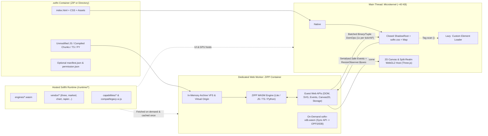
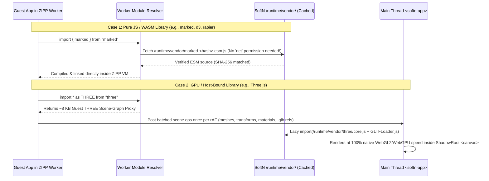

# SoftN v2 Redesign Blueprint: "Docker for Sandboxed Web Apps"

> [!NOTE]
> **This is the proposal the web container was built from, kept as it was written. It is not a description of what ships.** Parts of it are not built (an XDB engine on OPFS, the FormLogic frame and the desktop loader on `<softn-app>`, a v1 bridge for the element, a `Worker` of the app's own), and its links to files on the author's machine go nowhere. Some are built otherwise than written: an app's `indexedDB` is kept in the embedding page's storage with the rest of what it keeps, under one quota and the app's own storage prefix, not in a store of its own. For what the container does today, see the README's section on web containers, `packages/@softn/container`, and the CHANGELOG.

> [!IMPORTANT]
> **Core Architectural Shift:** SoftN transitions from a bespoke React-based `.ui` language into a **universal, capability-sandboxed Web App Container (`<softn-app>`)** powered by the [ZIPP](file:///E:/repos/zipp.org/README.md) Rust/WASM VM. Any standard HTML/CSS/JS/TS web app — **including unmodified, already-compiled Vite/React/Vue/Svelte/Canvas `dist/` builds** — can be zipped into a `.softn` archive and executed safely with zero code rewrites, while heavy libraries (like Three.js), UI extensions, and capabilities are hosted externally on the SoftN runtime and fetched strictly on demand.

---

## 1. Why Redesign? (v1 Bottlenecks vs. v2 Targets)

Today's SoftN runtime ([SoftNRenderer.tsx](file:///e:/repos/softn_redesign/softn.com/packages/@softn/core/src/loader/SoftNRenderer.tsx), [render.tsx](file:///e:/repos/softn_redesign/softn.com/packages/@softn/core/src/renderer/render.tsx), [script-runtime.ts](file:///e:/repos/softn_redesign/softn.com/packages/@softn/core/src/runtime/script-runtime.ts)) carries heavy structural overhead on every page load:

| Dimension | SoftN v1 (Current) | SoftN v2 (Redesigned Container) |
| :--- | :--- | :--- |
| **Authoring & Compatibility** | Custom `.ui` markup (`#if`, `#each`, `<logic>`) + 107 React components | **Any standard HTML/CSS/JS/TS/Python app** (unmodified compiled `dist/` *or* zero-build source) + legacy `.ui` fallback |
| **HTML / UI Parser** | ~325 KB custom TS lexer/parser ([lexer.ts](file:///e:/repos/softn_redesign/softn.com/packages/@softn/core/src/parser/lexer.ts), [parser.ts](file:///e:/repos/softn_redesign/softn.com/packages/@softn/core/src/parser/parser.ts)) | **0 KB** — Browser's native C++ `<template>` / `DOMParser` |
| **DOM Rendering Path** | 3 Virtual DOM layers (`shell-source.ts` -> `DocumentShell` AST -> React VDOM -> Browser DOM) | **1 Direct Surgical Patcher** (`Worker DOM Ops` -> `Map<nodeId, Node>` inside closed `ShadowRoot`) |
| **Startup JS Closure** | **~625–732 KB** (React + ReactDOM + `.ui` parser + [evaluate.ts](file:///e:/repos/softn_redesign/softn.com/packages/@softn/core/src/renderer/evaluate.ts) + eager [xdb-service.ts](file:///e:/repos/softn_redesign/softn.com/packages/@softn/core/src/runtime/xdb-service.ts)) | **~35–50 KB** (`softn.js` microkernel + sanitizer + DOM patcher + loader) |
| **Default WASM Engine** | **6.64 MB raw / 1.61 MB Brotli** (`zipp-javascript-python-base.wasm` for every app) | **2.65 MB raw / 716 KB Brotli** (`zipp-javascript-lite.wasm`), upgrading on demand |
| **Thread Isolation** | Forced onto **main UI thread** whenever `db.`, `window.`, `localStorage.`, or `host.` is used | **100% Web Worker isolated** by default (hard CPU instruction budget + `Worker.terminate()` wall-clock timeout) |
| **Vendor Libraries (Three.js, etc.)** | Bundled into host chunks or duplicated inside apps | **Externally hosted on `/runtime/vendor/`**, shared & cached once across all apps |
| **Manifest Requirement** | Fails with `ManifestError` if `manifest.json` is missing | **Zero-config ready:** zipping any `dist/` folder with `index.html` works out of the box |

---

## 2. High-Level Container Architecture

Every SoftN app runs inside a single framework-agnostic custom element — `<softn-app>` — which pairs a **Closed ShadowRoot Viewport** on the main thread with an **Isolated ZIPP Web Worker** off the main thread.



### Why This Solves UI Sandboxing Cleanly
- **HTML & CSS are rendered natively by the browser**, never by React. Untrusted markup is parsed into an inert `<template>`, sanitized once (stripping `<script>`, `<iframe>`, `<object>`, inline `on*` host handlers, `javascript:` URIs, and unpermitted external CSS/media URLs using the rules already proven in [sanitize-html.ts](file:///e:/repos/softn_redesign/softn.com/packages/@softn/core/src/renderer/sanitize-html.ts) and [prop-safety.ts](file:///e:/repos/softn_redesign/softn.com/packages/@softn/core/src/renderer/prop-safety.ts)), scoped inside a **closed `ShadowRoot`**, and stamped with integer node IDs.
- **All executable code runs strictly inside the ZIPP WASM Worker.** Even if an app contains minified Webpack/Vite React or Vue bundles, that framework runs *inside* ZIPP against the guest `document`, emitting compact node-ID patch batches (`create`, `setAttr`, `setText`, `insert`, `remove`) that the host applies directly to real DOM nodes in `O(1)` map lookups.

---

## 3. Running Any HTML Web App Unmodified ("Lift & Shift")

To make SoftN behave like **Docker for Web Apps** — where a developer can take an existing static web app or `npm run build` output (`dist/`), zip it as `my-app.softn`, and run it **without changing a single line of code** — the container provides five key mechanisms:

### 3.1 Zero-Config `.softn` Archives
Updating [manifest.ts](file:///e:/repos/softn_redesign/softn.com/packages/@softn/core/src/bundle/manifest.ts) so `manifest.json` and `permission.json` are **optional**:
1. **Entry Discovery Order:**
   - Explicit `manifest.json` -> `main`
   - Root `index.html` (or single root `*.html`, or single top-level folder `dist/index.html` when someone zips the folder itself!)
   - Legacy `ui/main.ui` -> routes automatically to `/runtime/compat/legacy-ui.js`
2. **Metadata Inference:** If `manifest.json` is absent, `name` comes from `<title>` (fallback: filename), `icon` from `<link rel="icon">` inside the archive, and `permissions` defaults to **strict zero-egress** (app's own bundled files + isolated app storage work; external internet/mic/camera are denied unless a `permission.json` or host policy grants them).

### 3.2 Native ES Module Graph & Dynamic `import()` in `zipp-wasm`
Compiled Vite/Rollup/ESBuild apps output ES module graphs (`<script type="module" src="./assets/index-D8a2.js">`) with static `import './vendor-C19f.js'` and code-split `await import('./Modal-9b1a.js')`.
- **Current gap:** [zipp-wasm/src/lib.rs](file:///E:/repos/zipp.org/crates/zipp-wasm/src/lib.rs#L755) exposes single-script `initScript(source)`, whereas `zipp-vm` in Rust *already* implements ES2025 modules (`import`/`export`, live bindings, `import.meta.url`, top-level `await`, dynamic `import()`).
- **v2 Upgrade in `zipp-wasm`:** Expose `Engine.initModule(entryPath, resolver)` + async dynamic-import host resolution:
  1. Relative/root paths (`./chunk.js`, `/assets/vendor.js`) resolve synchronously from the `.softn` archive VFS in the Worker.
  2. Bare specifiers (`import * as THREE from 'three'`, `import { marked } from 'marked'`) resolve via `<script type="importmap">` in `index.html` or SoftN's built-in **Hosted Vendor Registry** (`/runtime/vendor/`).
  3. Built-in capability modules (`import { db } from 'softn:db'`) resolve to SoftN's lazy capability bridges.
  4. Classic `<script defer src="...">` and inline `<script>` tags execute in document order prior to `DOMContentLoaded`, matching standard browser startup semantics.

### 3.3 Virtual Origin (`https://app.softn.local/`) & Intra-Bundle `fetch()`
Compiled web apps routinely `fetch('./data/items.json')`, load `.wasm` files via `WebAssembly.instantiateStreaming(fetch('/engine.wasm'))`, swap ``, or use History API routing (`history.pushState(null, '', '/settings')`).
- **Virtual VFS Fetch:** Inside the Worker, `location` reflects a clean virtual origin (`https://app.softn.local/`). Any `fetch()` or `XMLHttpRequest` targeting `https://app.softn.local/*` (or relative URLs) reads directly from the `.softn` archive's demand-read index ([zip.ts](file:///e:/repos/softn_redesign/softn.com/packages/@softn/core/src/bundle/zip.ts)) with proper MIME types (`application/json`, `application/wasm`, `application/octet-stream`) and **requires zero `net` permission**.
- **Asset URL Rewriting on Host:** When the DOM patcher sets `src` / `href` / `poster` / `srcset` or CSS `url(...)` to a bundle-relative path, the host resolves it from `BundleBinaryStore` into a scoped `blob:` URL (with automatic revocation on unmount). External `https://` URLs are gated by `permission.json` (`net.allowed_hosts`).

### 3.4 Complete Web API Surface for Compiled Frameworks & HTML5 Apps
[shell-source.ts](file:///e:/repos/softn_redesign/softn.com/packages/@softn/core/src/document-shell/shell-source.ts) already implements ~85% of what React, Vue, Svelte, Preact, Solid, and Lit need (`createElement`, `createElementNS` for SVG, `Comment` anchors, `DocumentFragment`, `HTMLTemplateElement`, `MutationObserver`, `CustomEvent`, `history`, `matchMedia`, `crypto`). In v2, we modularize and complete the remaining gaps:

| Web API Needed by Compiled Apps | How SoftN v2 Container Provides It |
| :--- | :--- |
| **DOM + SVG + Shadow-Safe CSS** | Evolved guest DOM in the Worker emitting compact binary/tuple `DomOp`s directly to the host's `Map<nodeId, Node>` (no host React!). Inline `<script onclick="...">` handlers written in HTML are compiled inside ZIPP, never on the host. |
| **Layout Reads (`getBoundingClientRect`, `offsetWidth`, `clientWidth`)** | Host tracks observed/layout-queried elements with a single `ResizeObserver` + post-patch frame measure and syncs `[id, x, y, w, h, scrollW, scrollH]` into the Worker cache (`boxesMeasured` fast path) so popovers, virtual lists, and responsive charts get real geometry. |
| **`<canvas>` 2D (`getContext('2d')`)** | Guest `CanvasRenderingContext2D` records a compact typed-array command ring (`fillRect`, `arc`, `drawImage`, `fillText`, `putImageData`) flushed per `requestAnimationFrame` to the real host `<canvas>` (or `OffscreenCanvas` where zero-readback applies). Makes HTML5 Canvas games & Chart.js work unmodified! |
| **Web Storage & `IndexedDB`** | `localStorage`, `sessionStorage`, and a lightweight `indexedDB` key-value/object-store shim run synchronously/asynchronously in the Worker, namespaced strictly to the container's cryptographic `appId`. |
| **Web Audio (`Audio` / `AudioContext` subset)** | `new Audio('./sfx.wav')` and basic `AudioContext` buffer/oscillator graphs proxy cleanly through SoftN's existing gapless audio host ([audio.ts](file:///e:/repos/softn_redesign/softn.com/packages/@softn/core/src/runtime/host-calls/audio.ts)), auto-stopping when the container closes. |
| **Guest `WebAssembly` & `Worker`** | Bundled `.wasm` modules instantiated by guest JS run inside SoftN's memory-capped WASM sandbox ([wasm-worker.ts](file:///e:/repos/softn_redesign/softn.com/packages/@softn/core/src/runtime/wasm/wasm-worker.ts)); `new Worker('./worker.js')` spawns a child ZIPP Worker bound to the same archive VFS and capability grants. |

> [!NOTE]
> **Honest Boundary on Raw `canvas.getContext('webgl2')`:** Proxying 150+ low-level stateful WebGL2 calls (`gl.shaderSource`, `gl.texImage2D`, `gl.readPixels`) from arbitrary compiled engines (like raw Unity/Godot WebGL exports) over a Worker boundary has shader/GPU security implications and readback stalls. For 3D, SoftN provides **Hosted Split-Realm `three`** (`import * as THREE from 'three'`), `<softn-scene3d>`, and `<softn-wasm-app>` (software/pixel/WASI framebuffers). Raw WebGL2 command proxying can be explored later as an opt-in capability (`"gpu": true`).

---

## 4. Zero Custom Language: 100% Standard Web DOM + Bring Your Own Framework

SoftN v2 **retires custom template syntax completely** — no `#if`/`#each` directives, no custom `:bind`/`:text` attributes, and no host expression evaluator ([evaluate.ts](file:///e:/repos/softn_redesign/softn.com/packages/@softn/core/src/renderer/evaluate.ts) is retired). Every app is **100% standard HTML, CSS, and JavaScript/TypeScript DOM**:

1. **Vanilla HTML + JS/TS (Zero Build Step):**
   ```html
   <!DOCTYPE html>
   <html>
   <head>
     <link rel="stylesheet" href="softn:ui.css">
     <script type="module" src="./app.ts"></script>
   </head>
   <body class="container stack gap-md">
     <header class="row between">
       <h1>Fieldnotes</h1>
       <span id="remaining" class="badge">0 remaining</span>
     </header>
     <form id="task-form" class="row gap-sm">
       <input id="draft" placeholder="Add a note..." required>
       <button class="btn primary" type="submit">Add</button>
     </form>
     <ul id="task-list" class="stack gap-xs"></ul>
   </body>
   </html>
   ```
2. **Zero-Build Hosted Frameworks (`preact`, `vue`, `lit`, `react` from `/runtime/vendor/`):**
   Authors who want declarative UI without a build step simply import a framework directly from SoftN's cached `/runtime/vendor/` catalog:
   ```js
   import { createApp, ref } from 'vue'; // or 'preact', 'lit', 'react' — hosted on /runtime/vendor/!
   ```
3. **Pre-Compiled `dist/` Bundles (Vite / Webpack / Rollup / Svelte / React / Vue):**
   Zip any compiled production `dist/` directory into `my-app.softn` and run it directly inside `<softn-app>` with zero modifications.

---

## 5. Pay-As-You-Go Runtime & Externally Hosted Libraries (`/runtime/`)

Everything outside the ~40 KB container microkernel lives in a shared, content-hashed `/runtime/` tree hosted once on `softn.com` (or alongside any self-hosted `<softn-app>` deployment and cached by the PWA / Tauri loader):

```text
/runtime/
├── softn.js                          # ~35–45 KB entry: <softn-app>, sanitizer, DOM patcher, Worker loader
├── ui.css                            # ~5 KB theme tokens (--softn-*) & semantic styles (.stack, .card, .btn, <dialog>)
├── manifest.json                     # Content-hashed directory & importmap of engines, vendor libs, UI tags, capabilities
│
├── engines/                          # 1 selected automatically per container:
│   ├── zipp-javascript-lite.wasm     # ~716 KB br — DEFAULT for plain JS / compiled JS apps!
│   ├── zipp-javascript.wasm          # ~1.24 MB br — loaded only if script uses Intl or Temporal
│   ├── zipp-typescript.wasm          # Loaded only when bundle contains .ts / .tsx scripts
│   ├── zipp-python-base.wasm         # Loaded only when bundle contains .py scripts
│   └── zipp-torch.wasm               # Loaded only when Python imports `torch`
│
├── vendor/                           # EXTERNALLY HOSTED LIBRARIES (Apps import by name, never bundle!)
│   ├── three/                        # Split-realm: ~8 KB guest THREE proxy in Worker + lazy host WebGL2 & loaders
│   ├── chart/                        # Split-realm / Canvas2D hosted charting
│   ├── marked.esm.js                 # Pure-JS ESM -> fetched & compiled directly inside ZIPP
│   ├── d3.esm.js                     # Pure-JS ESM -> fetched & compiled directly inside ZIPP
│   └── rapier2d.wasm / rapier3d.wasm # Hosted WASM physics -> instantiated on demand
│
├── capabilities/                     # Loaded ONLY when imported (`import ... from 'softn:*'`) or used
│   ├── db.worker.js + softn-xdb.wasm # Rust softn-xdb compiled to WASM INSIDE Worker (sync CRUD + IDB/OPFS flush!)
│   ├── sync.js                       # Lazy Yjs P2P / WebSocket server sync
│   ├── media.js                      # Audio, Microphone, Camera, QR (zxing.wasm)
│   ├── net-fs.js                     # Allowlisted fetch & user-picked file handles
│   └── wasm-runner.js                # WASI / raw .wasm sub-worker execution
│
├── ui/                               # Auto-loaded Custom Elements via MutationObserver when <softn-*> tag appears
│   ├── datagrid.js                   # <softn-datagrid> (virtualized sorting/filtering)
│   ├── charts.js                     # <softn-chart>
│   ├── editors.js                    # <softn-code-editor>, <softn-rich-text>
│   ├── game-io.js                    # <softn-pixel-canvas>, <softn-audio-stream>, <softn-controls>, <softn-dpad>
│   ├── scene3d.js                    # <softn-scene3d> (consumes /runtime/vendor/three/)
│   └── wasm-app.js                   # <softn-wasm-app>
│
└── compat/
    └── legacy-ui.js                  # Loaded ONLY when opening a v1 .softn bundle with `ui/*.ui`!
```

### How External Library Hosting Works Without Breaking the Sandbox



> [!TIP]
> **Why `softn-xdb.wasm` Inside the Worker Is a Game-Changer:** In v1, any script calling `db.query()` was forced onto the main thread because `db.query()` is synchronous. Compiling [crates/softn-xdb](file:///e:/repos/softn_redesign/softn.com/crates/softn-xdb/Cargo.toml) to a compact `.wasm` module loaded on demand *inside the app's own Worker* (hydrated from IndexedDB/OPFS on init and flushing writes asynchronously) keeps `db.query()` **100% synchronous** for scripts while keeping **100% of apps in a Worker**!

---

## 6. Streaming `.softn` Bundles (No More 100% Upfront Download)

As documented in [BUNDLE_LOADING.md](file:///e:/repos/softn_redesign/softn.com/docs/engineering/BUNDLE_LOADING.md#L216-L233), v1 must download a 50 MB `.softn` archive completely before first paint because bundle identity is a single SHA-256 over the entire ZIP.

In v2, we support **both** single-file `.softn` ZIPs and **Merkle-Indexed Streaming**:
- `manifest.json` can carry an optional `integrity.entries` map (`{ "path": { "size": N, "sha256": "..." } }`), making the app's cryptographic identity the SHA-256 of the canonical manifest index.
- When served over HTTP (either as unpacked directory files or via HTTP Range requests against the ZIP central directory), `<softn-app>` downloads **only `manifest.json` + `index.html` + entry JS (~15 KB)** to paint immediately, and fetches + SHA-256-verifies `.glb` models, audio, and extra chunks only when the app touches them.

---

## 7. Backwards Compatibility & Monorepo Consolidation

### 100% v1 `.softn` Compatibility (`compat/legacy-ui.js`)
- Every existing `.softn` bundle in `softn-Examples` (`Fieldnotes`, `Pocket`, `SoftDOS`, `Blockscape`, `TexasHoldem`, etc.) has `"main": "ui/main.ui"` in `manifest.json`.
- When `<softn-app>` sees a `.ui` entry, it dynamically imports `/runtime/compat/legacy-ui.js`:
  - **Phase A (Immediate 100% fidelity):** `legacy-ui.js` wraps the existing `.ui` renderer as an isolated lazy chunk — zero regressions on day one, and **0 bytes** loaded for v2 HTML apps.
  - **Phase B (Full React retirement):** Add a `.ui` -> HTML + `<softn-*>` + JS compiler so legacy `.ui` bundles run directly on the v2 container engine, allowing React to be removed from runtime dependencies altogether.

### Monorepo Simplification
- **New Core Package:** `packages/@softn/container` (zero React dependencies; builds `/runtime/*`).
- **Rust Upgrades:**
  1. [E:\repos\zipp.org\crates\zipp-wasm](file:///E:/repos/zipp.org/crates/zipp-wasm/Cargo.toml): Add multi-file ES module graph + dynamic `import()` callback + ship `lite`, `javascript`, `typescript`, `python-base`, and `torch` `.wasm` artifacts into `/runtime/engines/`.
  2. [crates/softn-xdb](file:///e:/repos/softn_redesign/softn.com/crates/softn-xdb/Cargo.toml): Add a `wasm32-unknown-unknown` build target for Worker-local XDB (`softn-xdb.wasm`).
- **Host Apps Converge:** `softn-single`, `softn-single-private`, `formlogic-host`, `softn-web`'s player, and `softn-loader` (Tauri) all become thin shells mounting `<softn-app>`. `softn-studio` and `softn-builder` switch their default project format to standard `index.html` + `style.css` + `app.js`/`app.ts`.

---

## 8. Phased Implementation Roadmap

### Phase 1: Container Microkernel & Unmodified HTML/JS Execution
1. Upgrade `zipp-wasm` in `E:\repos\zipp.org` (or via adapter module loader) to support ES module graphs (`import`/`export`, dynamic `import()`, `import.meta.url`) and build `zipp-javascript-lite.wasm` + `zipp-javascript.wasm` + `zipp-typescript.wasm` into `/runtime/engines/`.
2. Create `packages/@softn/container` with `<softn-app>`, closed `ShadowRoot`, HTML/CSS sanitizer, `ui.css` base design tokens, surgical `Map<nodeId, Node>` DOM patcher, `ResizeObserver` geometry sync, and 2D `<canvas>` command buffer.
3. Implement zero-config `.softn` archive opening (`index.html` auto-discovery, virtual `https://app.softn.local/` intra-bundle `fetch` & `blob:` asset resolution) + optional `:bind`/`:text`/`@click`/`<template :each>` Worker binder.
4. **Milestone Gate:** Take a real unmodified compiled Vite app (e.g. a compiled Preact/React/Vanilla + Canvas `dist/` zipped into `.softn`) AND a zero-build `Fieldnotes` HTML app, run both inside `<softn-app>`, and benchmark cold/warm bytes & startup time against `apps/softn-single`.

### Phase 2: External `/runtime/vendor/` Registry & On-Demand Capabilities
1. Build `/runtime/manifest.json` + bare-specifier import resolver for hosted pure-JS/WASM libraries (`marked`, `d3`, `rapier`, etc.).
2. Build the Split-Realm `three` hosted library (`import * as THREE from 'three'` guest proxy -> lazy host Three.js WebGL2 + on-demand `GLTFLoader`/post-processing).
3. Implement lazy `softn:*` capability imports (`softn:db` in-Worker, `softn:sync`, `softn:net`, `softn:audio`, `softn:mic`, `softn:fs`, `softn:wasm`) + lightweight ShadowRoot permission consent bar.

### Phase 3: Lazy `<softn-*>` Custom Elements & Legacy `.ui` Bridge
1. Implement `MutationObserver` tag auto-loader for `/runtime/ui/*.js`.
2. Port core rich extensions to standalone Custom Elements (`<softn-datagrid>`, `<softn-chart>`, `<softn-code-editor>`, `<softn-pixel-canvas>`, `<softn-audio-stream>`, `<softn-controls>`, `<softn-qr-reader>`, `<softn-scene3d>`, `<softn-wasm-app>`).
3. Wire `/runtime/compat/legacy-ui.js` so every existing `.ui` bundle continues to open seamlessly.

### Phase 4: Unify Hosts, Studio, Builder & Streaming Manifests
1. Switch `softn-single`, `softn-web`, `formlogic-host`, and `softn-loader` to `<softn-app>`.
2. Update `softn-studio` AI prompts and `softn-builder` canvas to author standard `index.html` + `style.css` + `app.js`/`app.ts` containers.
3. Add optional Merkle per-entry SHA-256 manifest streaming for instant startup on large media bundles.

---

## 9. Decisions to Confirm Before Coding Phase 1

1. **Modifying `E:\repos\zipp.org` alongside `softn.com`:** Are you happy for us to add native ES module graph / dynamic `import()` hooks directly in `E:\repos\zipp.org\crates\zipp-wasm` (cleanest & fastest for multi-chunk compiled apps), or should we keep `zipp-wasm` untouched at first and transform ESM imports in the Worker loader?
2. **Initial Hosted Vendor Set (`/runtime/vendor/`):** Beyond `three` (with GLTF/OBJ/postprocessing) and charts, which external libraries would you most love to have pre-hosted out of the box (e.g., `marked`, `d3`, `lucide` icons, `rapier` physics, `confetti`, `matter-js`)?
3. **Reactive HTML Sugar Prefix:** For zero-build HTML apps, do you like the concise `:text` / `:bind` / `@click` shorthand (opted-in via `<html softn>` so it never touches compiled React/Vue templates), or explicit `s-text` / `s-bind` / `s-on:click` attributes?
